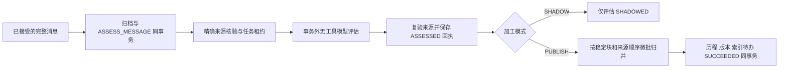

# 偏好异步评估与可靠微批归并验收（2026-10-20）

## 范围与状态

完成 `integrate-domain-agent-memory` 的 **7.2**，整体 **24/66**。后台评估、可靠回执、恢复归并及影子模式已实现。2026-10-21 完成 Docker 恢复后的联机复核与既有 Memory 容器部署，health/readiness 均为 200。自动加工仍按分阶段策略保持关闭。

自身、domain+agent 私有范围沿用 7.3/7.4。其他主体/共享偏好、Agent 装配、V2 RAG 和其他加工/索引/隐私清理消费者仍未实现。4.5 只有偏好子集完成，任务保持未勾选。普通入站只做既有可靠追加与任务入库，逐 delta/progress 未增加模型或 Memory 调用；本轮没有测正式业务 SSE 性能。

## 实现



- 任务以每次唯一租约和 attempt fence 防止过期 worker 提交；可到期接管、有限重试、失败终态。错误只保存枚举，不保存模型异常正文。模型调用不持 SQL 锁、不验证或换发用户 token，不获得通用读取/搜索权。
- 加工范围由部署明确注册，并与当前可信 source_caller 的 domain→agent 映射取交集。精确来源及传递依赖在读正文前、模型返回后和发布前复验；撤回或授权映射失效禁止发布。用户租约过期不冒充原用户。
- 模型只接收单条获准 USER 文本，区分 PREFERENCE/TASK_CONSTRAINT/QUESTION/OTHER、极性和变化类型；输出严格 JSON，拒绝未知/重复字段、工具调用、截断结束、未注册维度、重复维度、原文外值与凭据形状。主体/范围/来源/修正 ID 不交模型选择。assistant/工具消息不调用评估。
- extractionVersion 包含规则版本、实际逻辑模型标识与规则内容 hash。评估结果先保存，之后归并；重启与归并重试使用原回执，不再调用模型。不同模型版本升级不重解释已经评估的回执。
- 微批按逻辑块和同会话 sequence 排序，多个维度和任务回执原子提交；坏候选在批次回滚后逐事件隔离。归并复用原有完整历程校验与 reducer，不按 worker 完成时间覆盖旧值。模型不提供跨会话修正授权，同会话旧挂点由服务端链接。
- 临时例外只采用已有事项或原文出现的 ISO instant 有效期；缺少适用挂点不写长期默认。SHADOW 只存评估、不创建生产块和索引待办；模式变化不自动提升旧影子回执。
- 来源删除清除本会话评估正文并保留必要 hash/定位；派生块沿既有撤回规则立即不可读。外部副本未清理仍报告 DELETION_PENDING。

## 验证证据

本机回归 **302 项，零失败、零错误、零跳过**：common 54、common-memory 2、Supervisor/认证/编排 78、memory-service 168。该命令显式排除四个外部类。2026-10-21 环境恢复后，这四个外部类另行启用并全部通过，合计 **306 项不同用例通过**；不叠加重复运行计数。

- 15 项 worker 回归覆盖有界微批、修正顺序、模型故障后会话继续、有限重试、评估后重启/模型升级、到期接管/旧结果拒绝、撤回/删除、影子、普通用户权限失效但精确后台授权有效、SERVICE 加工映射撤销、非 USER 跳过、凭据、伪造来源和坏事件隔离。
- 严格模型解析 7 项、配置与默认关闭 3 项通过；普通应用关闭加工时不需要 AI 模型或密钥，不触发模型网络访问。
- 现有 MySQL 的档案、偏好历程、偏好处理三个外部类在故障前和 2026-10-21 恢复后均通过。新处理用例实际验证并发实例 claim、模型期间不持锁、原回执归并幂等及删除评估正文；使用随机私有 scope，正常结束精确清理。模型为受控 evaluator，Auth 为受控契约，不冒充真实登录用户业务链路。
- 最终规则下，既有开发网关 `gpt-5.6-terra` 的真实模型 4 组样例通过，覆盖偏好、长期修正、询问和临时例外。模型测试与 SQL worker 测试分别验证，不声称已跑通真实用户 SSE 到模型再到 RAG 的整链路。
- 初版规则复测曾把预期临时例外分类为 TASK_CONSTRAINT。补充既有默认/本次放宽的对照指引后复测通过，保留 **KI-142 LIMIT**，不将小样本当作完备语义保证。
- 完整 23 模块离线 compile、Memory 与上游 4 模块 package（跳过重复测试）、OpenSpec strict validate 通过。

2026-10-21 外部复核命令（真实 MySQL 与真实模型的环境变量仅在测试进程内注入）：

```powershell
mvn -o -gs .mvn-settings.xml -s .mvn-settings.xml -pl memory-service -am "-Dtest=MemoryArchiveMySqlTest,PreferenceHistoryMySqlTest,PreferenceProcessingMySqlTest,PreferenceLiveModelTest" "-Dsurefire.failIfNoSpecifiedTests=false" "-DforkCount=1" test
```

四个类各 1 项，零失败、零错误、零跳过；模型类包含 4 组真实样例。三个数据库用例结束后复查：新的偏好 fixture context/evaluation 均为零。中断测试另遗留一个无正文的 archive fixture header 和一条 SUMMARY 来源定位；按精确随机 context、owner/domain/agent、conversationId、summary/event 身份核对后，在事务中清理，最终两个专用 fixture 域的 context 均为零。

本机回归通过命令（外部类显式排除）：

```powershell
mvn -o -gs .mvn-settings.xml -s .mvn-settings.xml -pl agent-service,memory-service -am "-Dtest=Memory*Test,Memory*CompatibilityTest,Preference*Test,!MemoryArchiveMySqlTest,!PreferenceHistoryMySqlTest,!PreferenceProcessingMySqlTest,!PreferenceLiveModelTest,SupervisorToolLoopGraphTest,AgentRagCredentialLeaseStoreTest,OrchestrationStoreTest,SupervisorMemoryIntegrationTest,SupervisorMemoryPropertiesTest,SupervisorMemoryProjectionTest,SupervisorMemoryResultViewTest,SupervisorMemorySummaryGeneratorTest" "-Dsurefire.failIfNoSpecifiedTests=false" "-DforkCount=1" test
```

凭据仅从 `.env` 注入测试进程；日志/本记录不包含凭据。开发库测试连接现统一限制连接 5 秒、读取 15 秒（KI-143），防止依赖失联时测试与 finally 清理无限挂起。

## 迁移、制品与部署

迁移 170 添加 `memory_preference_evaluation`，既有迁移字节未改。manifest LF/SHA256 dry-run、既有 `bk-anent-dev-mysql-1` 的完整 upgrade/check 两次通过；2026-10-21 重启后完整清单再次复核通过，H2 fixture 也重复执行。迁移只建回执表，不自动启用加工。

本机新 JAR SHA-256：`b239260a5d54ed9a8bc5b72dca076496b4e009d88ff3d3d638908bc9d10221ce`。

2026-10-20 15:47 后的联机复核停在 MySQL 握手，Docker 列表查询及独立引擎 `_ping` 同时不返回。线程证据为 MySQL `readServerCapabilities`；宿主控制通道反复报内部 `192.168.65.7:2376` 不可达，虚拟机也存在明显内存压力，未证实为新 worker 引起。已精确结束当时卡住的 Maven/test 进程。

经用户明确授权后尝试 Docker 整体恢复。2026-10-21 确认只有 docker-desktop 在运行、Ubuntu 已停止；结束 Docker 自身进程、完整关闭 WSL 虚拟机并重新启动 Docker Desktop 后，宿主 Engine API 恢复。与单独终止 docker-desktop 发行版的先前尝试不同，此次完整 VM 关闭后控制通道可用。参考 [Docker 官方发布说明中的 WSL 启动挂起修复记录](https://docs.docker.com/desktop/release-notes/)，不据相似症状确定本机唯一根因；KI-124 保持 OPEN。

为遵循最小服务验证要求，暂时停止 10 个无关业务服务：interview、marketing-content、rag、notification、media-worker、settlement、contract、business、listing-master、compare-engine；保留认证、Agent、Memory、网关和现有基础依赖。未删除容器或卷，也未修改服务的 restart policy/资源配置。项目仍为 **31 个容器，14 个运行**，没有新测试/业务副本。

新镜像在本机已验证 JAR 上叠加构建，使用 Docker 自身的 builder，只对规范 `memory-service` 执行 `--no-deps --no-build` 更新。2026-10-21 09:35:44（Asia/Shanghai）复核：

| 项目 | 结果 |
| --- | --- |
| 容器 | `bk-anent-dev-memory-service-1` / `fc8ce442d108` |
| 镜像 | `sha256:c5d3831fb4c4f0c69b82bee560fa6ed145af62c56e6c044984621e662dac0d7a` |
| 实现版本标签 | `2cd4ea8` |
| 容器内 JAR SHA-256 | `b239260a5d54ed9a8bc5b72dca076496b4e009d88ff3d3d638908bc9d10221ce`（与本机一致） |
| health / readiness | 200 / 200，UP |
| restart count | 0 |

其余 **30 个容器的名称与 ID 均未改变**；Agent 仍使用原容器 `7f562b668421` 及原镜像。上述 10 个服务运行状态的暂时停止单独记录，不冒充所有服务都在运行。

默认 archive/processing/Agent V2 保持关闭，processing 默认 SHADOW。启用要求真实模型配置、当前可信 caller、精确 `allowed-agents-by-domain` 注册，并重启该服务使条件 Bean 生效；没有注册时不扫描正文。当前 RPC 数量仍为 14，没有新增内网 HTTP 客户端或放宽原生 USER 写权限。

## 关联

LR-70；KI-142/143。实现与超时修复提交：`2cd4ea8`，已推送 `origin/dev-fix`。本记录补全环境恢复、最终联机复核和部署证据。
