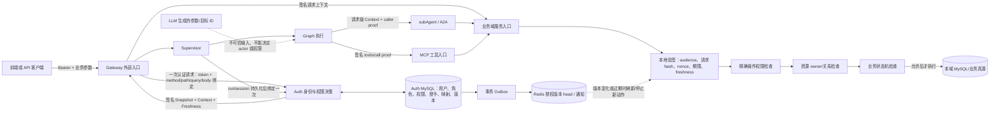

# Auth 权限体系清单与架构图

本文把当前仓库中的 Auth v2 权限模型、Agent 请求身份传递、业务域授权边界和验收状态放在一处，供后续实现与前端需求复用。它描述当前设计和代码证据，不代表所有业务服务已在生产启用。

状态口径以 `openspec/changes/unify-versioned-permission-context/tasks.md` 的当前勾选和 `implementation-progress.md` 最后追加的 2026-10-27 开发栈验收为准；历史章节可能保留当时的状态。

## 1. 设计结论

权限模型采用 **RBAC + 操作权限 + 资源关系/状态检查**：Auth 认证真实用户并计算明确的操作集合；入口和下游验证签名上下文；业务服务依据自己的数据真源检查资源归属和业务状态。

一次业务动作只有同时满足以下条件才允许执行：

```text
允许 = 有效用户/受限委托
    AND 签名上下文、受众、请求绑定、期限和授权版本有效
    AND 明确操作码已授予
    AND 目标资源归属或关系成立
    AND 业务状态允许该操作
```

关键约束：

- **Auth 是身份与操作权限的权威来源；业务服务是资源归属和业务状态的权威来源。** Auth 不替业务服务判断某条客户、房源、合同或内容属于谁。
- 权限码登记、角色授予、用户角色关联是三件不同的事。登记一个权限码不会自动授予所有普通用户。
- 普通用户权限是有效角色与显式授予的并集；用户角色有生效/失效时间。`businessAdmin` 是 Auth 保存的可信标记，可获取目录中有效操作，但不能绕过个人 Memory owner、业务资源关系或状态机。
- 未登记权限、缺少可信身份映射、过期或无法核验的上下文一律拒绝；不根据角色名称、模型输出、内网来源或资源 ID 推断权限。
- LLM 可以提出业务目标和参数，不能决定 `actor/userId`、`role`、`businessAdmin`、`brokerId`、`employeeId`、授权范围或请求所有者。
- 同一个 Graph run 内的多个工具/subAgent 调用复用已绑定身份和权限范围。每个传输边界验证签名上下文和请求证明；不对 Graph 中的每个节点重复远程查询 Auth。
- 授权通过不代表业务动作已经实现。签章、付款、外部营销发布等真实副作用仍由对应业务流程和状态机决定。

## 2. 权限职责清单

| 层 | 权威事实 | 负责判断 | 不负责判断 |
|---|---|---|---|
| Auth | 用户状态、真实登录凭据、角色、权限目录、有效授予、`businessAdmin`、业务身份映射、权限版本和认证 epoch | 谁是 actor；actor 可申请哪些已登记操作；签发/刷新/撤销受限上下文 | 某条业务记录是否真的属于 actor；业务状态是否允许发布/签章/付款 |
| Gateway | Bearer、真实请求方法/path/query/body、路由目标 | 清理客户端伪造身份头；为外部请求建立一次请求级 Auth 上下文；绑定转发请求 | 从请求字段或模型文本推导 actor/admin |
| Supervisor | 持久 run/session owner、原请求范围、审批与续接状态 | 持久执行身份确定后请求 Auth 绑定；把原范围带入 Graph 和子调用；控制刷新/恢复 | 扩大 Auth 签名范围，或让模型改写 run/session owner |
| Agent/A2A/MCP 边界 | Auth 签名上下文、服务调用方证明、实际请求正文、nonce | 本地验签、验 audience/期限/请求 hash/nonce；复用上下文；拒绝重放和篡改 | 用固定 caller、服务身份或内网来源代替用户授权 |
| 业务域服务 | 本域 SQL 记录、owner/关联表、审核/发布/状态机 | 检查精确操作码、资源 owner/关系和业务状态；在副作用前拒绝 | 重新相信模型给出的 actor/owner；把 Auth 权限当作状态转换成功 |
| MySQL/Auth Outbox | 角色/权限/映射/版本的持久权威数据 | 事务化写权限事实、审计和待发布事件 | 作为每个 Graph 节点的远程实时授权 API |
| Redis 授权 head/通知 | 已签快照的版本、状态与有界 freshness | 加速读、通知消费者版本变化、约束失效窗口 | 取代 MySQL 真源或自行增加权限 |

## 3. 权限对象与授权数据

| 对象 | 当前用途 | 设计检查点 |
|---|---|---|
| 用户与认证凭据 | 登录、refresh、me、logout；用户必须存在、启用且未删除 | 请求体中的 `userId` 不能代替真实凭据；撤销凭据会更新认证 epoch |
| 角色 | 将一组明确权限组织成可管理的业务角色 | 角色代码不是权限；`ADMIN`/`BROKER` 字符串本身不赋权 |
| 权限目录 | 保存 `permission_code → domain + operation + active + version` | 只允许稳定、可审查的精确操作码；未知码拒绝；停用/目录变化推动权限版本变化 |
| 角色权限 | 角色到目录操作的显式关联 | 不用 `*`、domain 前缀或工具名称泛化；权限登记不等于角色授予 |
| 用户角色授予 | 用户与角色的关联，含 active、`valid_from`、`valid_until` | 只计算当前有效授予；开始/到期边界须推动版本刷新 |
| 业务身份映射 | Auth 维护 `userId → business identity`，当前已实现 BROKER 映射 | 服务端签入上下文；模型字段和偶然相同的数字 ID 不构成映射 |
| `permissionRevision` | 权限/角色/映射变更版本 | 消费者发现变化后停止旧范围，并在合法边界刷新 |
| `credentialEpoch` | 用户凭据和账号失效版本 | 注销、停用等使旧执行上下文失效 |
| Outbox 与审计 | 将 Auth 数据变更与版本通知可靠关联 | 事务提交后发布；失败或状态不新鲜时不续用旧 head |
| Nonce/执行绑定 | 约束授权 RPC 重放和 Supervisor run/session 的持久绑定 | 耐久 nonce/owner 放在 Auth 或实际 provider 的持久库；不能仅靠进程内 Map |

## 4. Auth v2 上下文清单

Auth v2 不是把权限名放进普通请求头。下游使用经过签名、绑定特定执行/请求的授权材料，并在本地校验。

| 字段组 | 主要内容 | 校验目的 |
|---|---|---|
| actor 与权限 | `actorId`、`allowedOperations`、`permissionHash`、`permissionRevision`、`credentialEpoch` | 确认可信主体和授权范围未被替换或回放成旧版本 |
| 业务身份 | Auth 签入的 `businessIdentities`，如 `BROKER → brokerId` | 服务端从可信映射取得 broker，不从模型/请求正文取值 |
| 请求关联 | `audience`、`requestId`、run/session、`policyDigest`、请求 hash、nonce | 将授权限定到目标服务、本次执行、请求内容和调用策略 |
| 时间边界 | 签发、过期时间、run 硬截止；另有 freshness 的 `checkedAt/notAfter` | 硬截止不能由续租延长；过期、失效或 freshness 超窗时拒绝新动作 |
| 签名信息 | 算法、key id、签名 | 验证 Auth 对上下文的签发；服务间请求仍需验证对应 caller proof |
| 执行绑定 | 持久 run/session owner、原入口请求 hash、允许操作集合 | Supervisor 在真实 run/session 确定后由 Auth 建立执行关联，不能改写原 actor 或扩大原范围 |

`AuthorizationSnapshot` 是稳定的用户授权事实；`AuthorizationContext` 是限定受众、请求和执行的短期授权；`AuthzFreshness` 表明这些事实近期由权威来源核验。三者必须彼此匹配，不能单独拿其中一个当长期凭据。

## 5. 请求与权限检查体系图



### 一次用户请求的步骤

1. 用户经登录得到 access/refresh 凭据；前端后续只向 Gateway 发送凭据和业务输入。
2. Gateway 清除客户端提交的身份/授权伪造头，按真实请求调用 Auth 一次。Auth 校验用户状态、有效角色授予、目录操作、业务身份映射和当前版本。
3. Auth 签发限定 audience、方法、路径、query、body hash、policy、请求 ID、期限和操作集合的授权上下文。Gateway 转发时不把模型参数当 actor。
4. Supervisor 创建或恢复持久 run/session 后，在执行关联边界让 Auth 绑定这份上下文。actor、原允许操作、原 run 硬截止不能被子 Agent 改写。
5. Graph 内部多个工具/subAgent 复用绑定上下文；每个跨服务请求带独立请求证明和唯一 nonce，由接收服务本地验证。普通节点不逐次远程调用 Auth。
6. 业务方法检查精确 operation；再以本域数据库按 actor 的可信业务映射核 owner/关系，并核业务状态。只有所有检查通过才允许查询或副作用。
7. 权限/角色/身份映射变化由 Auth 更新版本、审计与 Outbox；Redis head/通知促使消费者停止旧权限或刷新。硬过期、已知撤权或 freshness 不足时关闭新动作。

## 6. 权限目录分域清单

下表是操作目录的组织清单，不是自动授予清单。具体目录定义见对应 Auth SQL migration 和本域服务守卫；每个 `.own`/`.all` 均应逐项确认其主体范围和角色授予策略。

| 域 | 操作类别 / 权限码示例 | 权威资源与额外边界 | 当前状态摘要 |
|---|---|---|---|
| Auth 管理 | `auth.users.manage`、`auth.roles.manage`、`auth.business-identity.manage` | 账号、角色和授权管理；管理动作本身也需真实管理员授权 | Auth→Gateway→Agent 开发链路已验；生产环境启用与发布仍须按 rollout 门禁执行 |
| Agent/Supervisor | `agent.chat.use`、`agent.workflow.read`、`agent.workflow.artifact.read`、`agent.workflow.invoke.*`、`agent.audit.*`、`agent.governance.*` | 持久 run/session/task owner；审批、取消、恢复和 artifact 仍校验原 owner 与状态 | Auth→Gateway→Agent 的真实开发 API 流程已验；多节点 Auth 调用数有本地回归 |
| RAG | `agent.rag.*`、`agent.vector-store.*`、`agent.rag.memory.search`、`agent.rag.listing.query`、`rag.space.manage` | Space/corpus/grant/source owner 和版本；候选授权不等于源数据可见 | 逐域实现；部署密钥、数据源和具体 RAG 路径按域验收 |
| Memory | `memory.read/write/search/share/revoke/delete`、`memory.constraint.*`、`memory.experience.governance.publish` | 个人数据始终按 owner 隔离；业务管理员不自动获得他人个人 Memory | 有请求级来源授权；真实 DB/撤权场景仍按任务验收 |
| Listing | `listing.read`、`listing.read.all`、`listing.create`、`listing.update.own/all`、`listing.delete.own/all`、`listing.status.update.*`、`listing.assets.bind.*`、`listing.ocr.*`、`listing.verify.*`、`listing.index.manage` | SQL `brokerId/status/revision`；私有详情和写入按 Auth 的 user→broker 映射核 owner | 源码与定向回归完成；真实 Listing provider 的跨服务端到端仍待验 |
| Customer | `customer.read`、`customer.read.all`、`customer.create`、`customer.update/delete.own/all`、`customer.follow.read/write.own/all`、`customer.entrust.read/write.own/all`、`customer.favorite.read/write.own/all`、`customer.match.own/all`、`customer.entrust.expiring.read`、`customer.reminder.send` | 客户、跟进、委托和收藏关联表为归属真源；请求体 brokerId 只能作一致性断言 | 源码与定向回归完成；无可信归属时拒绝 |
| Business | `business.kpi.read.all`、`business.workload.read.all`、assessment/ranking/turnover/store-dashboard/dashboard 操作 | 实际域为 Trade；目前缺 user→employee/store 映射，服务不信模型员工/门店 ID | 本地源码和 fixture 通过；未定义映射的访问保持关闭 |
| Settlement | `settlement.rule.*`、`settlement.calculate.all`、`settlement.record.*`、`settlement.split.*`、`settlement.generate.all`、`settlement.batch.*`、`settlement.commission.*` | 缺 user→employee/store/payee 关系、Contract 委托或银行签名回执的副作用拒绝 | 精确操作守卫已做；支付、批次等未证明的能力仍关闭 |
| Contract | `contract.template.*`、`contract.create.own`、`contract.read.*`、`contract.status.update.*`、`contract.attachment.ocr.*`、`contract.archive.*`、`contract.seal.*`、`contract.risk.*` | 合同 broker owner；附件先授权父合同；签章需真实签章服务和状态门 | 源码/定向回归完成；mock 签章不能标记 SEALED |
| Marketing/Promotion | `marketing.content.create.own`；`content.read.own/all`；`content.variant.create.own/all`；`assets.bind.own/all`；`publish.status.update.own/all`；`publish.execute.own/all`；`promotion.effect.read.all/sync.all`；`promotion.roi.read.all`；`brand-assets.read.all/write.all`（均带 `marketing.` 前缀） | 新内容 owner 从 Auth broker 映射写入；历史 owner 必须有可靠证据；发布状态仍受审批与外部渠道约束 | 目录 migration 有 16 个营销权限码，但该 migration 不自动授予 BROKER；实际角色授予需单独检查。新内容可限制在 DRAFT，真实发布未接通时拒绝 SUCCESS |
| Compare | `compare.report.create`、`compare.report.read.own`、`compare.report.share.public` | 报告 owner、固定来源快照 hash；公开分享需单独权限且只开放已发布快照 | 本地 owner/source 检查已实现；持久恢复与部署路径按域验收 |
| Media | `media.task.submit.*`、`media.task.read.*`、`media.generate.background` | taskId 只是定位符；后台 permit 绑定 actor、resource、请求 hash 与硬截止 | 许可守卫已实现；当前内存 TaskStore 不保证跨重启恢复，不能当生产耐久任务 |
| Notification | `notification.message.read.own`、`notification.message.mark-read.own`、`notification.message.send.own/all`、`notification.email.send.all`、`notification.robot.send.all`、`notification.workflow.events.read.all` | actor 与 recipient 分离；消息 SQL recipient 关系为真源；旧无 proof Dubbo 发送拒绝 | 源码与定向回归完成；Contract/Customer 提醒缺 recipient 映射，保持关闭 |
| Interview | `interview.initiate/read/respond/assist/end/report.generate/asset.submit/asset.publish/asset.regrade`、`interview.read.all` | session owner、participant relation、purpose ticket、报告/附件状态；短票不替代登录 | 服务端已加目的和 owner 检查；浏览器 fetch/SSE 和真实 ReactAgent 归档链冻结待前端接入 |

### 目录发布与授予检查

- [ ] 每个新操作码先定义业务动作、调用入口、目标资源、owner 关系和状态转换，再加入 Auth 目录 migration。
- [ ] 分别审查 `auth_permission`（目录）和 `auth_role_permission`/`auth_user_role`（实际授予）；不因目录出现就自动放行角色。
- [ ] 为 `.own` 和 `.all` 写清授予对象；`.all` 要求显式业务范围，不从管理员角色名称或请求参数推导。
- [ ] 迁移需有 schema check、幂等 repeat 证明、权限版本/outbox 影响和受控回滚方案；授权事实迁移按 forward-only 处理。
- [ ] 用户/角色/权限/业务映射变化需检查审计、revision/epoch、Redis 发布及旧上下文失效行为。

## 7. 前端与 LLM 身份边界

前端目前不在仓库。本节列出以后搭建前端时要进入需求单的能力；前端只能改善交互，不能替代服务端鉴权。

- 登录、refresh、logout、`/auth/me`；显示 Auth 返回的真实角色、多角色、businessAdmin 和权限版本，不用 UI 本地角色推导权限。
- 所有受保护 Agent API 经过 Gateway；凭据不放 query string，不由用户输入框或对话内容构造身份字段。
- 用户界面可以提供资源目标和业务参数；`userId`、`role`、`businessAdmin`、broker/employee owner 由服务端绑定。
- 不把 token、ticket、Auth context、caller proof 放进 prompt、Memory、进度事件、artifact、URL、analytics 或普通日志。
- Interview 需要认证 POST 领取短期 purpose ticket；浏览器以 fetch + ReadableStream 携带 Bearer 与专用票据请求 SSE，处理到期/撤销、重新领取和恢复。
- 前端展示“可操作”仅作提示；每次 API 请求仍由服务端核 operation、resource owner 和状态。

## 8. 当前验收与生产准入清单

### 已有证据

- [x] Auth 用户/角色/权限目录、签名授权上下文、版本状态、业务身份映射和执行绑定有源码及定向回归。
- [x] 逐域源码清单覆盖 Auth、Agent、RAG、Memory、Listing、Customer、Business、Settlement、Contract、Marketing、Compare、Media、Notification、Interview。
- [x] Auth→Gateway→Agent 的开发 API 验收记录包含登录、me、refresh、refresh 重放、伪造身份拒绝、logout 和撤销 token；秘密值不进入本文。
- [x] 最新开发栈记录显示既有数据库的 42 项 upgrade migration 及 schema check 已执行并重复通过；这不是 fresh DB 或生产回滚验收。
- [x] `tasks.md` 当前保留 8.3、8.4、11.1、11.4、11.6 五项未勾选；`implementation-progress.md` 历史摘要曾出现 57/63，最后追加记录与当前任务勾选为 58/63，本清单不以旧摘要代替任务状态。

### 上线前仍需逐域完成

- [ ] 真实 MySQL/Redis 的并发写、原子版本发布、outbox 延迟/乱序/丢失、授予到期、账号撤销和 freshness 超窗故障矩阵（11.1）。
- [ ] Auth、Gateway、Supervisor、common 协议和要启用的业务服务成组发布；确认每个服务的签名 key、audience、trusted caller、服务路由及数据库迁移版本一致。
- [ ] 按启用域真实验证 REST、Dubbo、A2A、MCP 入口都到达同一服务级权限/owner 守卫；覆盖跨用户、管理员范围、模型伪造 actor、请求正文重放、过期与撤权。
- [ ] 对 Marketing 明确普通 BROKER 的具体角色授予；核实历史内容 owner 来源。不能可靠回填的记录保持不可见/隔离。
- [ ] 对 Marketing 外部发布实现真实审核和渠道回执之前，不开放“已发布成功”；权限码不构成外部渠道上线证据。
- [ ] 完成开发栈真实 A2A 生命周期及 Interview 端到端（11.4）；未知或未运行的业务域保持未验状态。
- [ ] 完成 fresh/upgrade/repeat 和同等安全制品组回滚演练（11.6）；数据库鉴权迁移不降级、不删除授权事实。
- [ ] 前端建立后完成 8.3/8.4 浏览器领取、fetch/SSE、票据恢复，以及真实 ReactAgent 输出归档链；在此之前维持冻结标记。

## 9. 参考源

- [Auth 基线与 Gateway 入口规范](../openspec/changes/unify-versioned-permission-context/specs/authentication-baseline/spec.md)
- [业务域准入与跨协议授权规范](../openspec/changes/unify-versioned-permission-context/specs/domain-authorization-adoption/spec.md)
- [逐域实现与资源/状态矩阵](../openspec/changes/unify-versioned-permission-context/implementation-inventory.md)
- [当前实施进度与验收证据](../openspec/changes/unify-versioned-permission-context/implementation-progress.md)
- [逐任务状态](../openspec/changes/unify-versioned-permission-context/tasks.md)
- [版本化鉴权发布与回滚](authz-versioned-rollout-rollback.md)
- [Auth 基础权限迁移](../sql/migrations/20261023_versioned_authorization.sql)
- [业务域权限目录迁移](../sql/migrations/20261026_auth_business_identity_mapping.sql)
- [Marketing/Contract 权限目录迁移](../sql/migrations/20261026_contract_marketing_authorization.sql)
- [Marketing 内容归属迁移](../sql/migrations/20261026_marketing_content_owner.sql)
