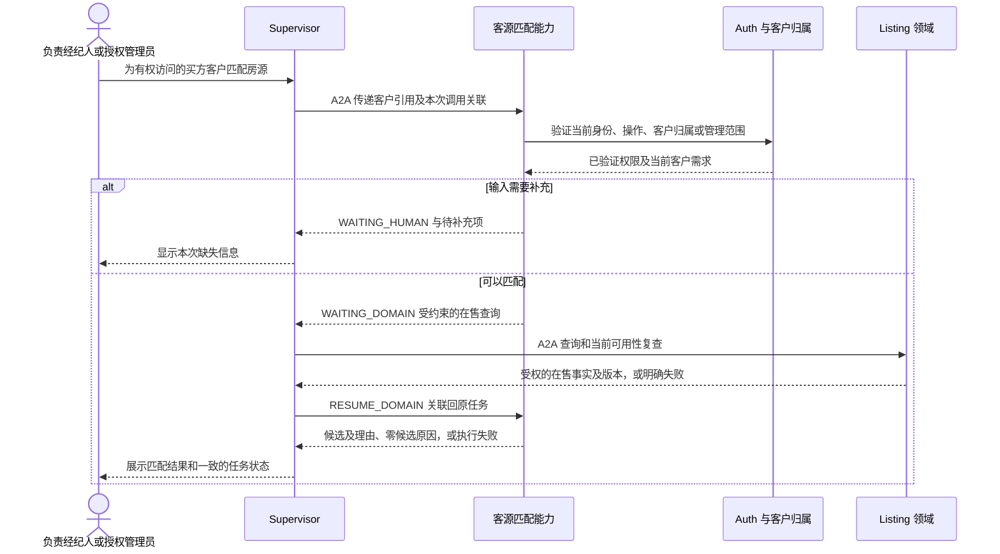

## Context

`CustomerManagementServiceImpl.createProfile` 已从可信用户写入 `owner_user_id`，同时保存经纪人映射 `broker_id`。搜索按归属过滤，`customer.read.all` 可扩大读取范围。当前详情还会组装已有跟进、委托和收藏，接口中存在这些资料的访问要求。

`matchListings` 在访问客户后读取偏好，用区域或户型作为检索词，对区域、户型和预算评分，返回最多十套房源及理由。区域和户型都为空时直接返回空列表，其他无候选情况也返回空列表。旧 Customer RPC 匹配入口目前要求认证而拒绝调用。实现接入须盘点实际可执行入口和签名权限。

## Goals / Non-Goals

**Goals**

- 客户归属与查看边界在登记、列表、详情和匹配中一致。
- 单次匹配读取获准需求和当前在售来源，输出候选及理由即完成。
- 统一表达成功有候选、成功零候选、等待补充及依赖失败。

**当前业务范围**

本期系统闭环至匹配结果交付。当前代码中的咨询状态和客户跟进入口需在功能盘点中注明用途，匹配任务本身以本提案定义的输出作为完成条件。

**待确认**

- 同一手机号由不同经纪人登记时的处理。
- 匹配需求的最低必填信息。
- 预算、区域、户型、面积哪些是必须满足的条件，哪些允许作为软偏好。

## Decisions

### 客源负责人和查看权限

新买方客源归录入经纪人，以可信 Auth 用户为 `owner_user_id`。`broker_id` 保存已验证的经纪人映射，业主档案和买方档案按 `profile_type` 区分。已核实归属的旧记录沿用现有证据和兼容路径。

普通经纪人查看自己负责的客户。授权管理员还需同时满足管理员身份、所需操作及当前资源范围。服务端统一应用该规则于搜索、详情、匹配、Agent 输入和产物读取。搜索的请求参数只用于收窄范围。其他经纪人的同部门关系不构成查看许可。匹配仅向有权读取该客户的人展示该客户相关结果，来源调用使用最小需求字段。

### 一次匹配的输入和结果

管理端入口复用现有 `CustomerController.matchedListings` 的调用路径。受监督入口通过共用 A2A 信封传递稳定的客户引用，Customer 域核对客户访问权并提供当前需求。依赖其他领域的检索或复核，由 Supervisor 关联领域委托及返回，再恢复原匹配。领域 Agent 名称及能力登记以运行目录和真实可执行入口为准。

每次匹配保存使用的需求摘要和来源观察时间。需求摘要可由已有偏好字段计算，用于区分多次修改需求后的结果。生成结果前复核房源在售状态及访问范围，候选返回稳定房源引用、当前资料版本、可展示事实和理由。可以使用模型理解需求、解释候选，理由中的事实与版本对应。

本次[动作 Schema](contracts/matching-actions.schema.json)使用 `customer.listings.match` 和客户编号，正常结果区分 `MATCHED` 与 `NO_MATCH`。通过既有[共用 A2A 信封](../align-listing-marketing-workflows/contracts/README.md)按动作和契约版本校验。输入不足与依赖失败使用信封的等待或失败分支。候选数量暂沿用当前最多十套，评分字段可选。摘要中的未知值显式为 `null`。

已成功获取全部所需来源并返回候选后，任务完成。检索成功且候选为零，以空候选及原因完成。输入不足进入 Supervisor 补充信息节点，来源失败保留失败或待重试状态。当前 `List<CustomerMatchResponse>` 在兼容期继续提供既有字段，新受监督结果使用明确的结果分支。上层判断任务完成时同时检查信封状态和业务结果。

### 数据流

### 主要表字段与边界

| 数据用途 | 现有字段或接口 | 设计约束 |
| --- | --- | --- |
| 客源档案与责任人 | `customer_profile.id, profile_type, name, mobile, broker_id, owner_user_id, source_channel, remark, deleted, created_at, updated_at` | 新登记负责人从可信身份取得，读取按负责人或管理员授权过滤 |
| 客户需求 | `preferred_area, preferred_layout, budget_min, budget_max, preferred_area_min, preferred_area_max, intention` | 服务端读取当前需求，按本次需求生成内容摘要。旧字段金额单位在适配时明确，防止万元与元混用 |
| 房源候选 | `listing_info.id, owner_user_id, title, address, layout, area, asking_price_yuan, status, version, deleted` | 仅当次可读、在售、未删除的房源，跨域金额用元及十进制字符串 |
| 当前匹配响应 | `CustomerMatchResponse.customerId, listing, matchReason, matchScore` | 保留已用字段和评分语义，补齐稳定引用、观察时间、版本与有结果/零候选分支 |
| 任务关联 | `agent_orchestration_run`、`agent_tool_invocation`、`agent_workflow_checkpoint` | 复用运行、调用、等待和结果记录，区分空结果与未执行成功 |

现有表依据 [Customer 初始化定义](../../../sql/migrations/20261013_mysql_init_bootstrap.sql#L107)及[用户负责人迁移](../../../sql/migrations/20261111_customer_user_owner.sql)。来源与任务字段沿用[已有数据流定义](../align-listing-marketing-workflows/dataflow.md)。

## Risks / Trade-offs

- 客户资料和匹配结果都具有客源查看边界，房源本身可见不代表可查看其对应客户。
- 当前详情响应组装多个旧业务对象，应使单纯查看客户资料只依赖该次需要的授权；关联资料各按对应权限返回。
- 评分权重、需求不足时如何补充、预算能否超出等规则仍待问答。实施时用真实业务决定替换临时的评分阈值，保留明确理由与对应事实。
