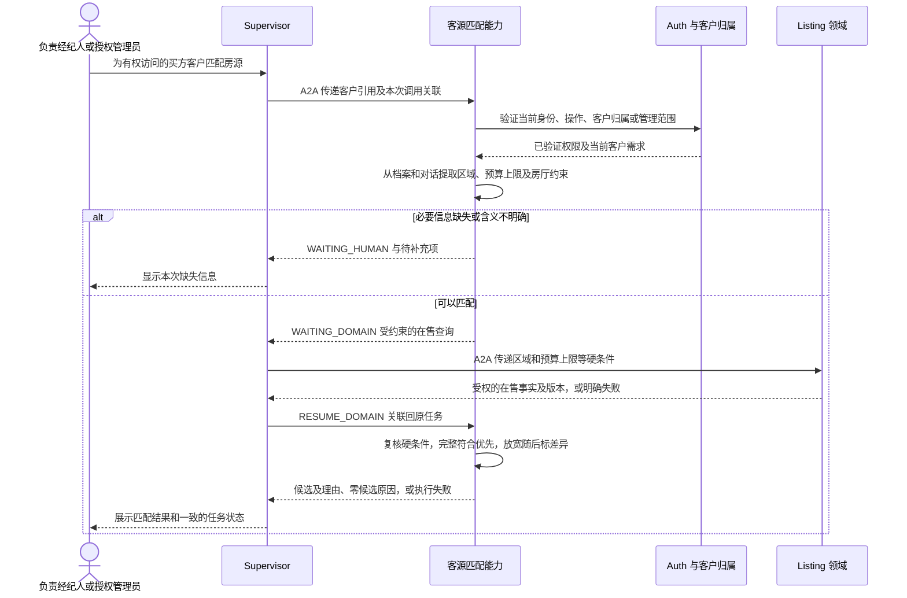

## Context

`CustomerManagementServiceImpl.createProfile` 已从可信用户写入 `owner_user_id`，同时保存经纪人映射 `broker_id`。搜索按归属过滤，`customer.read.all` 可扩大读取范围。当前详情还会组装已有跟进、委托和收藏，接口中存在这些资料的访问要求。

`matchListings` 在访问客户后读取偏好，用区域或户型作为检索词，对区域、户型和预算评分，返回最多十套房源及理由。区域和户型都为空时直接返回空列表，其他无候选情况也返回空列表。旧 Customer RPC 匹配入口目前要求认证而拒绝调用。实现接入须盘点实际可执行入口和签名权限。

当前 `customer_profile.mobile` 为普通索引，客户实体及登记请求没有身份证字段。`user_account` 当前也没有手机号字段，仅账号名有唯一索引。身份证身份与经纪人手机号唯一性需要新增相应字段和约束。

## Goals / Non-Goals

**Goals**

- 客户归属与查看边界在登记、列表、详情和匹配中一致。
- 单次匹配读取获准需求和当前在售来源，输出候选及理由即完成。
- 统一表达成功有候选、成功零候选、等待补充及依赖失败。

**当前业务范围**

本期系统闭环至匹配结果交付。当前代码中的咨询状态和客户跟进入口需在功能盘点中注明用途，匹配任务本身以本提案定义的输出作为完成条件。

**待确认**

- 买方客户是否必须在首次登记时提供身份证，或允许先保存待补充的需求草稿。
- 同一身份证已有关联经纪人时，其他经纪人的登记与私有需求应如何处理。

## Decisions

### 客源负责人和查看权限

新买方客源归录入经纪人，以可信 Auth 用户为 `owner_user_id`。`broker_id` 保存已验证的经纪人映射，业主档案和买方档案按 `profile_type` 区分。已核实归属的旧记录沿用现有证据和兼容路径。

普通经纪人查看自己负责的客户。授权管理员还需同时满足管理员身份、所需操作及当前资源范围。服务端统一应用该规则于搜索、详情、匹配、Agent 输入和产物读取。搜索的请求参数只用于收窄范围。其他经纪人的同部门关系不构成查看许可。匹配仅向有权读取该客户的人展示该客户相关结果，来源调用使用最小需求字段。

### 身份与联系电话

买方客户以身份证确定唯一身份。手机号为可重复的联系资料，买方与业主都可能填写亲属号码。经纪人自身手机号具有唯一性，按其账号或经纪人档案的登记入口校验。

客户身份证以受保护的文档数据及确定性查重标识表达，设计字段为 `identity_ref`、`document_ciphertext`、`document_lookup_key`，实际表归属在跨经纪人复用规则明确后确定。唯一约束针对客户身份，手机号不承担客户去重职责。规范化后的文档标识、联系方式和负责经纪人关联分别保存，重复请求与并发登记走同一业务约束。匹配请求及结果只传稳定客户引用，不携带完整身份证。

### 匹配条件与顺序

区域和预算上限是必要硬条件。Agent 可从客户档案及对话提取已有证据，缺失或含义不确定时通过 Supervisor 补问。区域需映射为可核实的区域范围，预算统一为元。匹配前及候选输出前都检查实际房源属于指定区域，且价格不高于上限。

用户明确指定“几房几厅”时，将已指定的房数与厅数分别保存为精确约束。仅明确房数时只强制房数。旧 `preferred_layout` 可保留原文，并新增结构化的 `layout_constraint_json` 记录严格项与可放宽偏好。只有当前来源能证明满足硬条件的房源才能参与排序。

普通户型偏好与面积属于软条件。结果限额内优先列出满足全部软偏好的候选，剩余额度再列满足硬条件但偏离部分软偏好的候选。每套结果标记 `EXACT_PREFERENCES` 或 `RELAXED_PREFERENCES`，放宽候选附偏好值、实际值和差异说明。组内排序沿用可解释评分，两个组的先后优先于评分。若全部候选不满足硬条件，返回真实的零候选，等待用户明确变更需求后再进行新的匹配。

### 一次匹配的输入和结果

管理端入口复用现有 `CustomerController.matchedListings` 的调用路径。受监督入口通过共用 A2A 信封传递稳定的客户引用，Customer 域核对客户访问权并提供当前需求。依赖其他领域的检索或复核，由 Supervisor 关联领域委托及返回，再恢复原匹配。领域 Agent 名称及能力登记以运行目录和真实可执行入口为准。

每次匹配保存实际使用的结构化条件、需求摘要和来源观察时间，并关联对话证据或档案字段。需求摘要用于区分多次修改需求后的结果。生成结果前复核房源在售状态及访问范围，候选返回稳定房源引用、当前资料版本、可展示事实和理由。可以使用模型理解需求、解释候选，理由中的事实与版本对应。

本次[动作 Schema](contracts/matching-actions.schema.json)使用 `customer.listings.match` 和客户编号，允许携带从本次对话提取的结构化条件。服务端验证客户权限与条件，未携带时读取档案并按需要补问。本次条件随任务记录保存，档案偏好通过显式编辑操作更新。正常结果区分 `MATCHED` 与 `NO_MATCH`，两者均带实际采用的条件快照。通过既有[共用 A2A 信封](../align-listing-marketing-workflows/contracts/README.md)按动作和契约版本校验。输入不足与依赖失败使用信封的等待或失败分支。候选数量暂沿用当前最多十套，评分字段可选，房源价格需明确且不超过上限。

已成功获取全部所需来源并返回候选后，任务完成。检索成功且候选为零，以空候选及原因完成。输入不足进入 Supervisor 补充信息节点，来源失败保留失败或待重试状态。当前 `List<CustomerMatchResponse>` 在兼容期继续提供既有字段，新受监督结果使用明确的结果分支。上层判断任务完成时同时检查信封状态和业务结果。

### 数据流

### 主要表字段与边界

| 数据用途 | 现有字段或接口 | 设计约束 |
| --- | --- | --- |
| 客源档案与责任人 | `customer_profile.id, profile_type, name, mobile, broker_id, owner_user_id, source_channel, remark, deleted, created_at, updated_at` | 新登记负责人从可信身份取得，读取按负责人或管理员授权过滤 |
| 客户需求 | `preferred_area, preferred_layout, budget_min, budget_max, preferred_area_min, preferred_area_max, intention` | 服务端读取当前需求，按本次需求生成内容摘要。旧字段金额单位在适配时明确，防止万元与元混用 |
| 结构化匹配条件 | 当前区域与户型主要为文本字段 | 新增或投影 `region_refs_json, budget_upper_yuan, layout_constraint_json, criteria_hash, criteria_source_refs`。保留原字段及对话证据，明确必要条件和软偏好 |
| 身份与联系资料 | 客户联系电话沿用 `customer_profile.mobile` | 买方身份证身份用受控引用和文档查重标识唯一约束。买方及业主联系电话可重复，经纪人手机号唯一。具体人员身份与经纪人私有资料关联待后续决策确定 |
| 房源候选 | `listing_info.id, owner_user_id, title, address, layout, area, asking_price_yuan, status, version, deleted` | 仅当次可读、在售、未删除的房源，跨域金额用元及十进制字符串 |
| 当前匹配响应 | `CustomerMatchResponse.customerId, listing, matchReason, matchScore` | 保留既有字段及兼容读取，评分仅用于组内排序，补齐稳定引用、观察时间、版本与有结果/零候选分支 |
| 任务关联 | `agent_orchestration_run`、`agent_tool_invocation`、`agent_workflow_checkpoint` | 复用运行、调用、等待和结果记录，区分空结果与未执行成功 |

现有表依据 [Customer 初始化定义](../../../sql/migrations/20261013_mysql_init_bootstrap.sql#L107)及[用户负责人迁移](../../../sql/migrations/20261111_customer_user_owner.sql)。来源与任务字段沿用[已有数据流定义](../align-listing-marketing-workflows/dataflow.md)。

经纪人账号字段依据[账号实体](../../../auth-service/src/main/java/com/bkanent/auth/entity/UserAccountEntity.java#L9)及[账号表](../../../sql/migrations/20261013_mysql_init_bootstrap.sql#L17)。手机号唯一与身份证查重均为本期新增设计。

## Risks / Trade-offs

- 客户资料和匹配结果都具有客源查看边界，房源本身可见不代表可查看其对应客户。
- 当前详情响应组装多个旧业务对象，应使单纯查看客户资料只依赖该次需要的授权；关联资料各按对应权限返回。
- JSON Schema 验证字段、必填项及结果分支，实际区域归属、金额比较、明确房厅相等、组间排序由领域运行逻辑验证。模型分数不能替代这些检查。
- 旧文本户型或地区资料若不能可靠解析，保留来源值和未知项；针对本次硬条件无法证实的候选，先返回可核实的其他候选。
