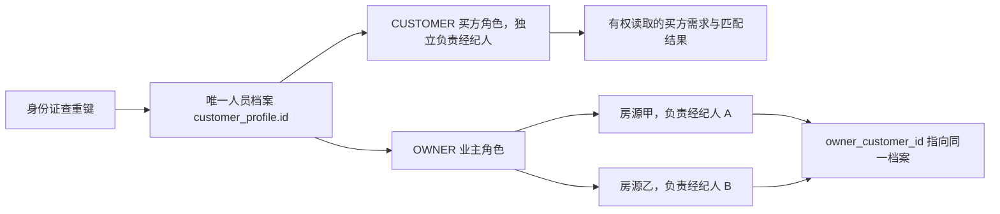
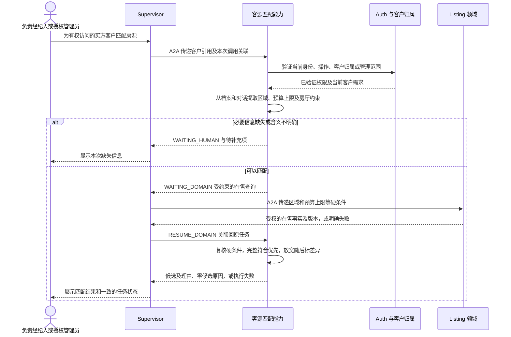
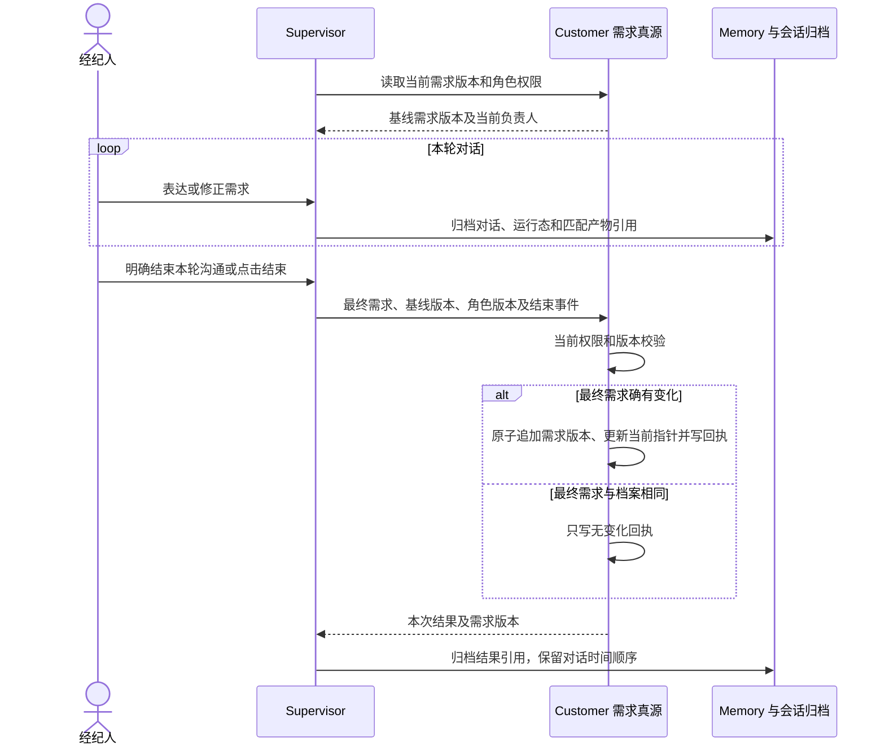

## Context

`CustomerManagementServiceImpl.createProfile` 已从可信用户写入 `owner_user_id`，同时保存经纪人映射 `broker_id`。搜索按归属过滤，`customer.read.all` 可扩大读取范围。当前详情还会组装已有跟进、委托和收藏，接口中存在这些资料的访问要求。

`matchListings` 在访问客户后读取偏好，用区域或户型作为检索词，对区域、户型和预算评分，返回最多十套房源及理由。区域和户型都为空时直接返回空列表，其他无候选情况也返回空列表。旧 Customer RPC 匹配入口目前要求认证而拒绝调用。实现接入须盘点实际可执行入口和签名权限。

当前 `customer_profile.mobile` 为普通索引，客户实体及登记请求没有身份证字段。`user_account` 当前也没有手机号字段，仅账号名有唯一索引。身份证身份与经纪人手机号唯一性需要新增相应字段和约束。

当前 `profile_type` 为单值 `CUSTOMER` 或 `OWNER`，普通更新会覆盖该字段。房源业主验证要求 `OWNER` 类型，且引用现有档案依赖负责人归属或全量读取权限。多角色和跨经纪人房源引用需要同步调整数据表示及授权投影。

## Goals / Non-Goals

**Goals**

- 客户归属与查看边界在登记、列表、详情和匹配中一致。
- 单次匹配读取获准需求和当前在售来源，输出候选及理由即完成。
- 统一表达成功有候选、成功零候选、等待补充及依赖失败。

**当前业务范围**

本提案中的单次匹配任务以候选及理由交付为完成条件。2026-11-27 用户将系统整体范围延伸至对比后的多轮带看、带看情况登记和成交；后续办理由 `align-sales-followup-and-business-review` 继续设计，不改变匹配动作自身的完成条件。当前代码中的咨询状态和客户跟进入口需在功能盘点中注明用途。

**后续业务问题**

角色停用和身份证错误更正的流程，随后续功能逐项确认。

## Decisions

### 客源负责人和查看权限

首次以买方用途登记人员档案时，买方角色负责人取当前经纪人的可信 Auth 用户。`broker_id` 保存已验证的经纪人映射。人员身份以同一个档案编号维持唯一，业务角色允许同时包含 `CUSTOMER` 和 `OWNER`，每套房源保存自己的负责经纪人。已核实归属的旧记录沿用现有证据和兼容路径。

普通经纪人按买方角色的 `owner_user_id` 查看自己负责的需求及匹配资料。授权管理员还需同时满足管理员身份、所需操作及当前资源范围。服务端统一应用该规则于搜索、详情、匹配、Agent 输入和产物读取。搜索的请求参数只用于收窄范围。其他经纪人的同部门关系不构成买方资料查看许可。

经纪人负责的房源引用某份档案时，可查看该业主的姓名、联系方式以及自己负责的关联房源。该经纪人和当前授权管理员可校正共同业主姓名、联系电话等基础信息，记录前后值、操作人和时间。买方预算、区域、偏好和匹配结果由买方角色权限单独控制。完整身份证不放入业主联系信息投影。

共享联系资料修改拟增加 `profile_version` 及变更历史，按预期版本原子保存，避免 A、B 同时修改而静默覆盖。历史保存允许的字段前后值及实际操作人。角色添加、身份证身份及角色负责人采用各自的明确操作，联系资料更新只修改对应字段。

### 身份与联系电话

买方客户首次登记必须提供身份证，以证件确定唯一身份。手机号为可重复的联系资料，买方与业主都可能填写亲属号码。经纪人自身手机号具有唯一性，按其账号或经纪人档案的登记入口校验。

客户身份证以受保护的文档数据及确定性查重标识表达，拟在一对一的 `customer_profile_identity` 保存 `profile_id, document_ciphertext, document_lookup_key`，证件查重键唯一。它引用同一个人员档案编号，手机号保存在联系资料中。匹配请求及结果只传稳定客户引用。

首次登记缺少身份证时，提示补充所需信息，尚不创建人员档案。经纪人 B 提交已由 A 登记的身份证并尝试新建时，返回稳定业务结果 `IDENTITY_ALREADY_EXISTS`。查重定位到同一档案，继续办理使用既有引用。重复命中本身不授予 B 查看原有买方需求或接管其负责人的权限。

同一创建请求的重试返回其原结果。真正的新请求若命中已有证件，按重复登记处理。数据库唯一约束与事务共同处理并发首次登记，确保只有一份成功档案。历史缺少证件的记录按原事实保留，新增登记规则及补录路径在受管迁移中分别落实。

### 同一档案的买方与业主角色

复用 `customer_profile.id` 作为人员档案编号，房源的 `owner_customer_id` 继续指向这个编号。拟新增 `customer_profile_role` 保存 `profile_id, role_code, owner_user_id, created_at, created_by_user_id`，以 `profile_id + role_code` 唯一表示角色。`CUSTOMER` 行的 `owner_user_id` 表示买方需求负责人。`OWNER` 角色的使用范围由各套房源关联和当前操作授权决定。

迁移按原 `profile_type` 生成已有角色。原为 `CUSTOMER` 的记录按已核实主表归属初始化买方角色负责人，原为 `OWNER` 的记录只生成业主角色。原字段及原登记归属保留兼容，新增买方角色后，读取权以角色负责人为准。

搜索、匹配和业主验证按角色集合判断。买方匹配要求存在 `CUSTOMER` 角色，房源关联要求存在 `OWNER` 角色，同一编号可以同时满足两者。给原档案添加角色时追加对应角色记录，日常编辑只修改明确提交的资料，不通过覆盖旧类型删除另一个角色。旧接口的单值字段按其兼容用途映射，真实的角色集合由版本化 DTO 提供。

若 A 原先以业主身份建档，此人之后找 B 买房，B 可以在原档案添加 `CUSTOMER` 角色，其买方需求归 B。原有房源及其负责人继续按各房源记录管理。若该档案已经有买方角色，重复新建或再次添加角色不会转移既有买方负责人。角色添加使用唯一约束及稳定请求身份处理并发和重试。

买方角色的负责人转交由有相应操作及客户范围权限的管理员办理，目标须为当前有效的经纪人。记录原负责人、新负责人、管理员、时间及请求标识。角色版本随转交递增，后续读写按当前负责人校验。原经纪人不能用未结束的旧会话继续提交该客户需求。当前负责人的该客户业务历程可随转交读取，原操作者和原会话归属保留其历史事实。

同一位业主的多套房源可以分别由 A、B 负责，人员档案不随各套房源的经纪人复制。业主引用验证按房源关联用途及当前资源范围返回必要引用，完整买方资料读取另行鉴权。首次房源创建使用已认证的登记动作及拟关联的档案验证引用，后续联系信息读取根据已保存的房源负责人关系校验，避免初次关联依赖尚未建立的房源关系。

### 匹配条件与顺序

区域和预算上限是必要硬条件。Agent 可从客户档案及对话提取已有证据，缺失或含义不确定时通过 Supervisor 补问。区域需映射为可核实的区域范围，预算统一为元。匹配前及候选输出前都检查实际房源属于指定区域，且价格不高于上限。

用户明确指定“几房几厅”时，将已指定的房数与厅数分别保存为精确约束。仅明确房数时只强制房数。旧 `preferred_layout` 可保留原文，并新增结构化的 `layout_constraint_json` 记录严格项与可放宽偏好。只有当前来源能证明满足硬条件的房源才能参与排序。

普通户型偏好与面积属于软条件。结果限额内优先列出满足全部软偏好的候选，剩余额度再列满足硬条件但偏离部分软偏好的候选。每套结果标记 `EXACT_PREFERENCES` 或 `RELAXED_PREFERENCES`，放宽候选附偏好值、实际值和差异说明。组内排序沿用可解释评分，两个组的先后优先于评分。若全部候选不满足硬条件，返回真实的零候选，等待用户明确变更需求后再进行新的匹配。

### 一次匹配的输入和结果

管理端入口复用现有 `CustomerController.matchedListings` 的调用路径。受监督入口通过共用 A2A 信封传递稳定的客户引用，Customer 域核对客户访问权并提供当前需求。依赖其他领域的检索或复核，由 Supervisor 关联领域委托及返回，再恢复原匹配。领域 Agent 名称及能力登记以运行目录和真实可执行入口为准。

每次匹配保存实际使用的结构化条件、需求摘要和来源观察时间，并关联对话证据或档案字段。需求摘要用于区分多次修改需求后的结果。生成结果前复核房源在售状态及访问范围，候选返回稳定房源引用、当前资料版本、可展示事实和理由。可以使用模型理解需求、解释候选，理由中的事实与版本对应。

本次[动作 Schema](contracts/matching-actions.schema.json)使用 `customer.listings.match` 和客户编号，允许携带从本次对话提取的结构化条件。服务端验证客户权限与条件，未携带时读取档案并按需要补问。本次条件随任务记录保存，对话运行态采用下面的沟通结束规则落档。正常结果区分 `MATCHED` 与 `NO_MATCH`，两者均带实际采用的条件快照和业务记录引用。通过既有[共用 A2A 信封](../align-listing-marketing-workflows/contracts/README.md)按动作和契约版本校验。输入不足与依赖失败使用信封的等待或失败分支。候选数量暂沿用当前最多十套，评分字段可选，房源价格需明确且不超过上限。

已成功获取全部所需来源并返回候选后，任务完成。检索成功且候选为零，以空候选及原因完成。输入不足进入 Supervisor 补充信息节点，来源失败保留失败或待重试状态。当前 `List<CustomerMatchResponse>` 在兼容期继续提供既有字段，新受监督结果使用明确的结果分支。上层判断任务完成时同时检查信封状态和业务结果。

### 对话运行态与需求时间链

会话开始时记录客户当前需求版本，作为本轮基线。对话中的预算、区域及偏好修正保存在工作上下文，供当次匹配使用，并由已接入的 Agent 与 Memory 生命周期可靠归档。中间表达及其顺序保留在对话中。买方业务需求版本由 Customer 域维护，登录经纪人的个人偏好 Memory 按其原本主体和作用域使用。

未提及的字段继承本轮基线，明确取消某项要求才将该字段清空。最终快照由基线与已明确的需求变化合并，探索性比较继续保留其对话语义。相同人员在多段会话中的运行态分别关联基线版本，按提交时的当前业务状态复核。

用户明确表示结束本轮沟通，或点击结束会话后，Supervisor 记录经过认证的结束事件和最终运行态。一次普通 Agent 轮次收尾和匹配结果交付各保留自己的状态。本次结束事件使用稳定 `closure_id`，绑定接受到的消息序号、当前客户、最终需求快照及其来源依据。确认最终仍有需求变化时直接提交，原负责人或当前获准主体的现行权限在提交处复查。

拟新增 `customer_demand_revision` 追加完整需求快照、相对上版的变化、实际操作人、发生时间、来源会话及结束事件，并以独立 `demand_version` 串联。已有偏好列保留为当前版本的兼容投影，与新版本记录及当前版本指针在同一事务提交。运行态曾多次变化但最终恢复已落档状态时，不新增业务版本；对话过程仍可回看。

同一 `customer_id + closure_id` 的重复提交返回原回执。`customer_demand_commit_receipt` 同时保存有变化与无变化的提交结果，无变化回执无需制造一份业务需求版本。重新打开同一会话后再次结束，生成新的结束事件。提交先核验当前角色及最终状态，需要实际变更时按基线需求版本校验，较旧运行态不能直接覆盖新档案。版本不符时恢复上下文并展示差异，再依用户明确的当前表达继续处理。

[结束落档与负责人转交 Schema](contracts/demand-actions.schema.json)登记 `customer.demand.finalize` 与 `customer.buyer-role.transfer`。结束事件和来源引用由服务端按原会话核实，实际管理员或经纪人身份取签名上下文。需求快照允许保留尚未明确的字段，执行匹配时再按区域和预算上限的必要条件检查。已有偏好只知道当前值时，迁移记录为当时观察到的基线，不反推不存在的历史修改。

### 会话历史、Memory 与转交

匹配以 `customer_match_record` 保存客户编号、实际条件、候选和理由的业务快照，关联 `conversation_id`、调用及观察时间。会话产物和 Memory 保存该业务真源的版本化引用，并在会话历史中还原当时的匹配结果。重开旧会话时恢复旧对话，同时取当前档案并展示需求差异。继续发起新的匹配时按当次条件重新取得在售事实。

所有官方领域 Agent 和 Supervisor 继续采用现有必须接入的 Memory 生命周期。业务记录按当前客户角色授权，领域私有工作集和登录人个人偏好保留原有的 owner/domain/agent 作用域。基础记忆接入、checkpoint 真源、交付重试与索引投影语义沿用 LR-64、LR-76、LR-77、LR-96、LR-97。

已核实 `SupervisorMemoryLifecycle.beforeTools` 在存在历史摘要或前序运行消息时阻止外部能力调用，LR-65 将原因记录为跨域持久导出授权尚未接通。旧会话继续匹配需补齐绑定精确来源、目标 Agent/context、用途与版本的 export/grant 交接，并在发送前复核当前权限。依赖撤回和权限失效仍按现有约束处理。仅让页面恢复旧文本不足以达到可续接业务的验收目标。

需求版本与匹配记录以 Customer 业务真源提供 `DOMAIN_RECORD` 引用。Memory 采用现有的 `MemorySourceRef` 版本、来源事件和上下文定位机制，Customer 来源适配器验证当前角色权限。Supervisor 的记忆交付继续引用不可变 checkpoint，记忆重试按原事件和来源引用交付，已经保存的匹配或需求变更可以复用其回执。

管理员转交买方负责人后，B 可按当前角色读取该客户的需求版本和匹配业务记录。用于交接的客户业务投影只包含对应客户的记录及必要来源引用。A 的完整私有会话、其他客户资料和个人偏好仍按各自原权限读取。B 在自己的会话中使用获准业务记录继续工作，无需把 A 的整段私人工作集改为 B 所有。

### 数据流

首次登记按证件唯一查重，业务角色和房源引用复用同一档案。

### 主要表字段与边界

| 数据用途 | 现有字段或接口 | 设计约束 |
| --- | --- | --- |
| 客源档案与责任人 | `customer_profile.id, profile_type, name, mobile, broker_id, owner_user_id, source_channel, remark, deleted, created_at, updated_at` | 保留历史字段，买方需求的新授权以对应角色负责人为准，业主联系信息按房源关联范围返回 |
| 身份与业主档案引用 | 现有档案无证件身份字段，房源的业主引用使用 `listing_info.owner_customer_id` | 拟在 `customer_profile_identity(profile_id, document_lookup_key, document_ciphertext)` 查重并保护证件，同一 `profile_id` 兼具买方与业主角色。买方资料按角色权限读取 |
| 人员业务角色 | 历史 `customer_profile.profile_type` 单值记录保留 | 拟新增 `customer_profile_role(profile_id, role_code, owner_user_id, created_at, created_by_user_id)`，买方需求负责人独立记录，房源引用仍使用同一档案 ID |
| 买方需求时间链 | 当前偏好直接位于 `customer_profile.preferred_area, preferred_layout, budget_min, budget_max, preferred_area_min, preferred_area_max` | 拟新增 `customer_demand_revision(revision_id, profile_id, demand_version, previous_version, closure_id, conversation_id, run_id, demand_json, changed_fields_json, source_refs_json, operator_user_id, occurred_at, recorded_at)`，以 `profile_id + demand_version` 唯一。当前版本指针及旧列投影同事务更新 |
| 结束落档回执 | 当前没有对应的需求结束回执表 | 拟新增 `customer_demand_commit_receipt(profile_id, closure_id, request_hash, outcome, demand_version, revision_id, created_at)`，以 `profile_id + closure_id` 唯一，支持无变化及重试 |
| 会话匹配业务记录 | 当前响应为 `CustomerMatchResponse`，Agent 侧有任务和产物存储 | 拟新增 `customer_match_record(match_id, profile_id, conversation_id, run_id, request_id, criteria_hash, criteria_json, result_json, observed_at, created_by_user_id)`。会话中的 `matchRecordId` 引用该快照，便于重开与客户业务交接 |
| 负责人转交 | 买方角色使用规划中的 `customer_profile_role.owner_user_id` | 增加 `role_version`，拟新增 `customer_role_transfer_record(transfer_id, profile_id, from_owner_user_id, to_owner_user_id, operator_user_id, request_id, from_role_version, to_role_version, created_at)`，与当前负责人原子变更 |
| 会话与记忆真源引用 | `agent_workflow_checkpoint.task_id, session_id, snapshot_json, checkpoint_version`；`agent_task_artifact.artifact_id, task_id, session_id, version_no, content_json, metadata_json`；`agent_memory_delivery.context_id, event_id, run_id, checkpoint_version, message_ordinal, sequence_no, content_hash, permit_id, state` | 在产物和来源引用中关联客户业务记录的 ID、版本与用途，沿用 checkpoint 定位及交付重试，客户权限与私有会话权限分别检查 |
| 共享联系信息校正 | 当前 `customer_profile.name, mobile, wechat_no, updated_at` | 拟增加 `profile_version` 和 `customer_profile_change_record(profile_id, from_version, to_version, changed_fields_json, operator_user_id, request_id, created_at)`，按当前作用域返回可见字段 |
| 客户需求 | `preferred_area, preferred_layout, budget_min, budget_max, preferred_area_min, preferred_area_max, intention` | 服务端读取当前需求，按本次需求生成内容摘要。旧字段金额单位在适配时明确，防止万元与元混用 |
| 结构化匹配条件 | 当前区域与户型主要为文本字段 | 新增或投影 `region_refs_json, budget_upper_yuan, layout_constraint_json, criteria_hash, criteria_source_refs`。保留原字段及对话证据，明确必要条件和软偏好 |
| 身份与联系资料 | 客户联系电话沿用 `customer_profile.mobile` | 新登记买方身份证必填，以受控引用及文档查重标识唯一约束。重复命中定位同一身份及既有业主档案。买方及业主联系电话可重复，经纪人手机号唯一 |
| 房源候选 | `listing_info.id, owner_user_id, title, address, layout, area, asking_price_yuan, status, version, deleted` | 仅当次可读、在售、未删除的房源，跨域金额用元及十进制字符串 |
| 当前匹配响应 | `CustomerMatchResponse.customerId, listing, matchReason, matchScore` | 保留既有字段及兼容读取，评分仅用于组内排序，补齐稳定引用、观察时间、版本与有结果/零候选分支 |
| 任务关联 | `agent_orchestration_run`、`agent_tool_invocation`、`agent_workflow_checkpoint` | 复用运行、调用、等待和结果记录，区分空结果与未执行成功 |

现有表依据 [Customer 初始化定义](../../../sql/migrations/20261013_mysql_init_bootstrap.sql#L107)及[用户负责人迁移](../../../sql/migrations/20261111_customer_user_owner.sql)。来源与任务字段沿用[已有数据流定义](../align-listing-marketing-workflows/dataflow.md)。

经纪人账号字段依据[账号实体](../../../auth-service/src/main/java/com/bkanent/auth/entity/UserAccountEntity.java#L9)及[账号表](../../../sql/migrations/20261013_mysql_init_bootstrap.sql#L17)。手机号唯一与身份证查重均为本期新增设计。

记忆交付字段依据[持久交付迁移](../../../sql/migrations/20261019_supervisor_memory_delivery.sql#L9)，会话产物依据[初始化定义](../../../sql/migrations/20261013_mysql_init_bootstrap.sql#L800)。私有偏好主体与跨域历史使用边界见 [LR-65](../../../docs/logic-rationale.md#L649) 和 [LR-97](../../../docs/logic-rationale.md#L945)。

## Risks / Trade-offs

- 客户资料和匹配结果都具有客源查看边界，房源本身可见不代表可查看其对应客户。
- 当前详情响应组装多个旧业务对象，应使单纯查看客户资料只依赖该次需要的授权；关联资料各按对应权限返回。
- JSON Schema 验证字段、必填项及结果分支，实际区域归属、金额比较、明确房厅相等、组间排序由领域运行逻辑验证。模型分数不能替代这些检查。
- 旧文本户型或地区资料若不能可靠解析，保留来源值和未知项；针对本次硬条件无法证实的候选，先返回可核实的其他候选。
