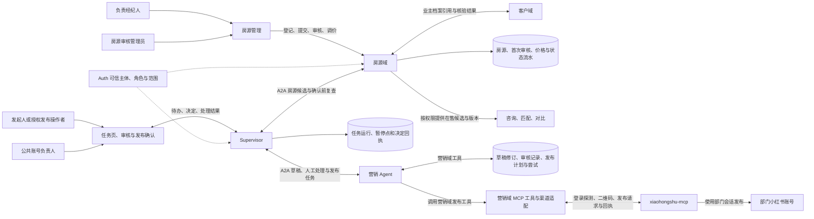
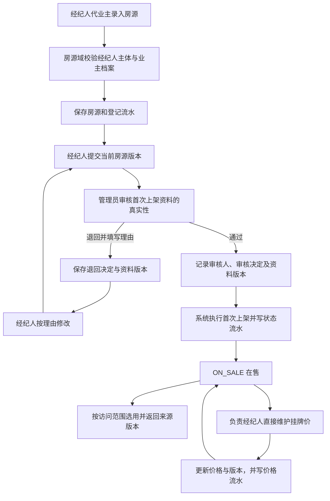
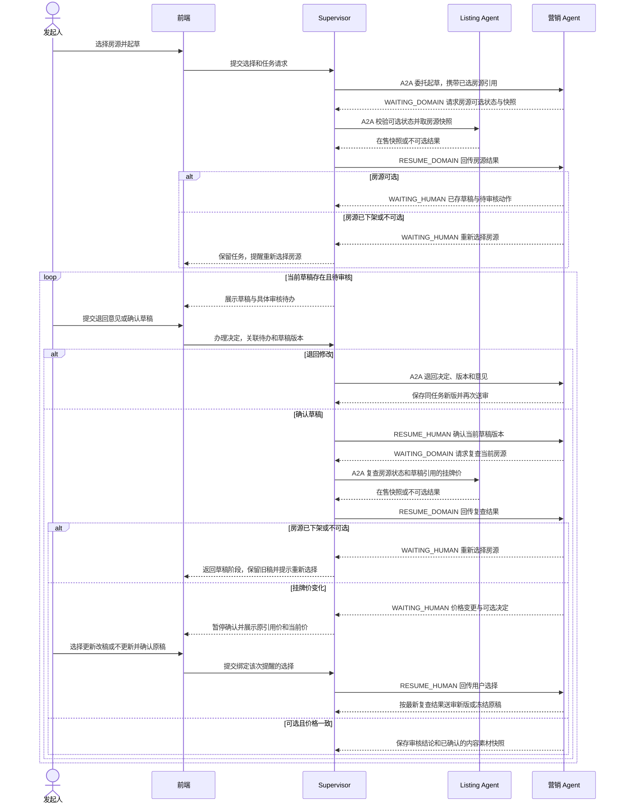
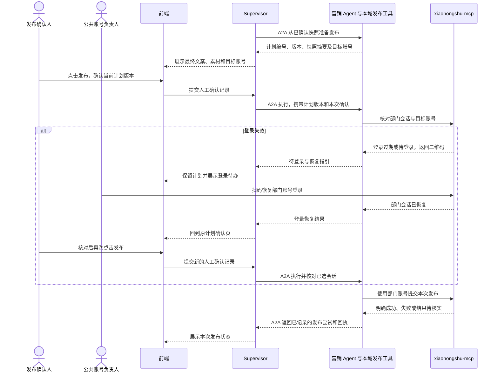

# 房源登记、审核上架与营销发布数据流

本图对应一期目标流程。房源域维护挂牌状态和价格，客户域提供受权业主档案，营销域维护内容与发布结果。Supervisor 保存任务和人工待办，经 A2A 传递业务请求与恢复决定。下文「现有字段」以受管 SQL 为依据，「目标记录」为设计字段，实际表名与迁移实现由实施确定。 [提案](proposal.md) · [受管初始化清单](../../../docker/mysql/init-manifest.tsv)

## 系统上下文

## 房源登记、首次上架与调价

- 首次上架审核覆盖当前提交版本中的业主关联与基础展示信息。提交或退回留在房源管理范围，负责人和有权限的管理员按管理规则查看。审核通过和上架各留业务记录，可在同一事务提交。版本不符时向操作者展示当前资料并要求重新核对。产权、委托、合同、OCR 和核验资料沿用各自的既有业务含义。
- 负责经纪人调整挂牌价时，同事务提交原价与新价、操作者、时间、请求编号、更新后的版本和索引待更新记录。价格审核与首次上架真实性审核采用各自的动作。匹配、对比和营销草稿的候选及引用复查统一要求 `ON_SALE`；房源全量读取权限决定访问范围。 [现有登记和调价实现](../../../listing-master-service/src/main/java/com/bkanent/listing/service/impl/ListingManagementServiceImpl.java#L165) · [管理与选用规则 LR-196](../../../docs/logic-rationale.md#L1778)
- 重大字段变更是否触发再审核，以及人工下架、重新上架的角色和流程，留待业务决策。

## 营销草稿、房源复查和人工决定

草稿可以多次退回。每次使用原任务和草稿标识，保存新的草稿版本并创建新待办，同一退回决定重放时复用已经生成的新版。重新选择房源后先取新房源快照，再在原任务内送审。调价时，用户选择「不更新，确认原稿」可继续发布准备，营销域同一笔审核记录须能说明「已提示调价，用户选择不更新」，并保留原引用价、提示时现价、发生时间、操作者和内容版本。草稿审核通过时绑定审核对象、素材及房源事实快照。此后发布阶段以该冻结快照为输入。 [现有内容版本与发布快照](../../../sql/migrations/20261026_marketing_campaign_lifecycle.sql#L2) · [审核素材版本缺口 KI-276](../../../docs/known-issues.md#L2262)

## 发布确认、渠道登录和人工重发

发布只核对渠道执行所需的信息，包括计划版本、快照、确认记录、目标账号会话、素材交付和回执。部门账号与平台确认人的身份分别记录。MCP 明确返回成功时，本次业务发布办结并保存响应；外部笔记 ID 按渠道实际返回记录。登录恢复只打开原确认页，由本次确认人再次点击。渠道返回不明确时，保留原尝试与状态以便核对。

人工发现漏发时，原确认人或相应部门发布管理员登记「确认未发布」，保存复核人、时间、原因和原尝试引用。操作人核对并明确确认重发后，创建新的发布尝试，关联原确认、原尝试及本次确认。同一次点击重复送达复用同一回执。原回执与人工复核记录可一起查看。 [现有请求、回执和尝试 SQL](../../../sql/migrations/20261026_marketing_campaign_lifecycle.sql#L90)

## 主要表与字段

| 落库方与用途 | 现有表与字段 | 目标记录及关联 |
| --- | --- | --- |
| Auth 和 Customer 提供可信身份、业主与部门关系 | `bk_auth.user_account.id`；`auth_user_business_identity.user_id, identity_type, identity_id`；`auth_org_membership.user_id, org_id, status, valid_from, valid_until`；`bk_customer.customer_profile.id, profile_type, owner_user_id`。 [用户和客户表](../../../sql/migrations/20261013_mysql_init_bootstrap.sql#L17) · [业务身份](../../../sql/migrations/20261026_auth_business_identity_mapping.sql#L4) · [组织](../../../sql/migrations/20261110_auth_organization.sql#L27) · [客户负责人](../../../sql/migrations/20261111_customer_user_owner.sql) | `actor_user_id` 取可信 Auth 主体，`broker_id` 取受信经纪人映射；`owner_customer_id` 引用客户域 `OWNER` 档案。发布管理员权限和部门范围用 Auth 事实核验。 |
| Listing 房源及上架 | `listing_info.id, broker_id, owner_user_id, owner_customer_id, title, address, community_name, district_code, layout, area, floor_level, decoration, school_zone, traffic, total_price, asking_price_yuan, status, ocr_status, verification_status, verification_source, verification_remark, version, deleted`。主表还有历史 `owner_name, certificate_no, property_certificate_url, contract_url` 字段。关联 `listing_asset.listing_id, asset_type, storage_key, visibility, status` 和 `listing_private_info.listing_id, certificate_no_ciphertext, certificate_key_id`。 [房源表](../../../sql/migrations/20261013_mysql_init_bootstrap.sql#L71) · [扩展列和子表](../../../sql/migrations/20261105_listing_internal_business.sql#L5) · [房源负责人](../../../sql/migrations/20261111_listing_user_owner.sql#L4) | 首次审核记录绑定 `listing_id`、审核资料的 `listing_version`、`submitted_by_user_id`、`submitted_at`、审核决定、审核人、审核时间及退回理由。上架流水关联审核记录，业务状态转入 `ON_SALE`。 |
| Listing 价格、状态及写入回执 | `listing_price_record.listing_id, old_price_yuan, new_price_yuan, reason, operator_user_id, request_id, created_at`；`listing_status_record.listing_id, from_status, to_status, action, reason, operator_user_id, request_id, created_at`；`listing_command_receipt.actor_user_id, operation, request_id, request_hash, listing_id, status`。 [房源流水与回执](../../../sql/migrations/20261105_listing_internal_business.sql#L126) | 复用现有流水和操作归属。对外来源快照携带 `listingRef`、`revision`、`contentHash`、价格单位、挂牌状态及观察时间，供 Supervisor 交给营销确认流程。 |
| Supervisor 任务暂停、待办与续接 | `agent_orchestration_run.run_id, user_id, request_json`；`agent_tool_invocation.run_id, call_id, capability_id, arguments_hash, status, result_json, remote_association_json`；`agent_workflow_checkpoint.task_id, session_id, trace_id, workflow_status, pending_approval_id, snapshot_json, checkpoint_version`；`agent_workflow_approval_claim.approval_id, task_id, approval_version, decision_status, result_json`。 [编排日志](../../../sql/migrations/20261004_supervisor_orchestration.sql#L3) · [暂停点与审批回执](../../../sql/migrations/20261013_mysql_init_bootstrap.sql#L761) | 待办关联 `runId`、原 A2A Agent 和子任务、`actionId`、动作与契约版本、业务对象和版本、办理人或授权范围、展示快照引用。续接记录携带决定标识与实际操作者；重复提交核对动作和内容摘要后复用结果。 |
| Marketing 草稿版本与人工内容审核 | `marketing_content.id, listing_id, owner_user_id, title, copywriting, asset_urls, cover_image_url, video_url, version_no, audit_status, status`；`marketing_campaign_content_revision.id, content_id, revision_no, content_hash, snapshot_json, data_mode, created_at`。 [草稿表](../../../sql/migrations/20261013_mysql_init_bootstrap.sql#L235) · [内容负责人](../../../sql/migrations/20261111_marketing_user_owner.sql#L4) · [内容修订表](../../../sql/migrations/20261026_marketing_campaign_lifecycle.sql#L2) | 保存草稿修订与素材摘要、原稿中的房源引用和来源版本。审核决策绑定该修订、审核人、时间、退回意见，并关联 Supervisor 决定。调价审计包含提醒编号、展示的新旧价格与单位、当前来源版本、用户选择和最终保留的草稿版本。 |
| Marketing 发布计划与目标账号 | `marketing_campaign_plan.plan_id, owner_user_id, content_id, content_revision, content_hash, asset_hash, targets_hash, snapshot_hash, plan_version, status, content_snapshot_json, assets_snapshot_json`；`marketing_campaign_plan_target.plan_id, target_index, platform, account_id, account_revision, external_account_ref, arguments_hash`；`marketing_campaign_account.id, platform, external_account_ref, permission_code, revision_no, active`。 [账号、计划及目标](../../../sql/migrations/20261026_marketing_campaign_lifecycle.sql#L35) | 计划绑定已通过的草稿审核记录。平台用户的发布确认绑定 `plan_id`、`plan_version`、`snapshot_hash`、目标账号、本次确认人和时间；部门归属绑定共享渠道账号。会话凭据由渠道适配维护。 |
| Marketing 执行、回执与人工重发 | `marketing_campaign_publish_request.plan_id, owner_user_id, request_id, body_hash, receipt_id`；`marketing_campaign_publish_receipt.receipt_id, plan_id, request_id, status, data_mode`；`marketing_campaign_publish_attempt.attempt_id, receipt_id, plan_id, target_index, account_id, status, external_publish_id, message, attempt_version`；`marketing_campaign_outbox.event_id, attempt_id, state`；`marketing_campaign_event.event_id, attempt_id, event_type, payload_json, created_at`。 [发布流水](../../../sql/migrations/20261026_marketing_campaign_lifecycle.sql#L90) | 本次执行与确认记录关联；重发增加原尝试引用和人工复核记录。现有请求表 `UNIQUE(plan_id)` 需要演进为可保留多次受确认发布请求的存储关系，继续对单次点击执行幂等。 |

## 关键验收点

| 场景 | 从用户操作追溯到的结果 |
| --- | --- |
| 新登记、退回后重提、首次审核通过 | 管理可查 → 待审核记录绑定版本 → 审核通过有记录 → 只在 `ON_SALE` 后进入候选。 |
| 在售房源调价 | 价格和版本同步更新，原价、新价、操作者、时间和请求编号可查。 |
| 草稿退回、确认期间调价或下架 | 同任务生成新版并重新送审，或明确确认保留原价并有提醒审计；下架返回草稿阶段并保留原任务。 |
| 草稿通过、发布计划确认 | 保存的发布版本可按确认记录追溯到草稿和素材快照；确认后的房源价格变化留在房源业务中。 |
| 部门小红书账号待登录或人工重发 | 扫码之后展示原计划并由本次确认人再次点击；MCP 回执与原尝试、复核决定、新尝试均可单独查询。 |
