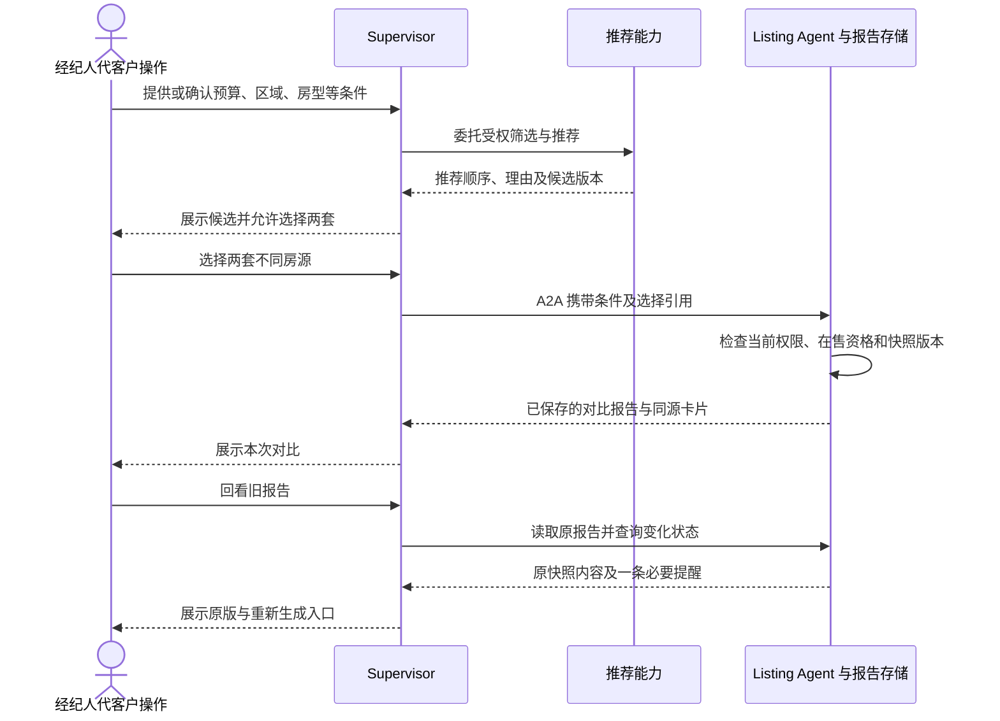

## Context

`ListingComparisonService.create` 使用稳定房源引用和预期版本，取得来源快照后生成报告。`getOwned`、`loadPdf` 都调用同一个 `verifyCurrent`，来源为 `STALE` 时抛版本冲突，下架房源会由在售来源适配器返回不可访问。当前实现难以按用户要求读取变化后的旧报告。

`ListingComparisonReportStore` 已将 `ownerActorId, cacheKey, sourceVersionHash, report, storedAt` 写入磁盘。相同操作者、来源和规则的缓存命中返回原 `reportId`。报告快照可继续作为真源，生成关系和历史读取回执需要补齐。

## Goals / Non-Goals

**Goals**

- 按当前预算、区域、房型等条件先推荐并说明理由，再明确选择两套生成对比。
- 当前有权使用且在售的房源可从推荐或筛选结果中任意选择。
- 旧版保持历史事实，打开时简短提醒变化，用户按需重新生成。

**操作场景**

经纪人在现有授权界面代客户操作。可直接输入临时条件，也可选择已建档买方并使用其当前运行态需求。

## Decisions

### 筛选、推荐及两套选择

筛选和推荐使用临时输入或建档买方的当前需求条件。区域、预算上限及用户明确指定的房厅数量遵循已确认的硬条件，普通户型偏好和面积可放宽。先展示完整符合偏好的候选及推荐理由，放宽候选随后标明差异。已绑定买方时，采用其获准的本次运行态需求；临时输入按会话工作上下文保存，产生受权的推荐与报告产物。

经纪人可在推荐列表或同条件的房源筛选结果中选择两套不同房源。每套均需当前有权使用、在售并符合本次硬条件，选择资格以房源事实与使用权限为依据。创建时重新取得当前快照并校验，失去资格的选择返回可处理的业务状态。对现有通用比较入口的 2–6 套调用继续按其发布契约处理，本期互动选房入口固定为两套。

Supervisor 处理页面交互，经 A2A 委托实际领域能力。Listing 域处理来源校验和报告事实，推荐环节消费结构化需求并保存排序理由。绑定客户时，客户需求及产物仍按其买方角色权限读取。

Listing Agent 复用已有找房与比较能力承接推荐和对比。建档客户的需求通过受权业务来源及 Supervisor 跨域回转取得。首屏推荐数量暂沿用已有最多十套的设置，其他符合条件的房源仍可从筛选结果选择。临时条件不触发人员建档或买方档案需求落档。

### 推荐理由与报告事实

推荐结果保存条件摘要、候选顺序、逐套理由及所用房源版本。对比报告保存用户实际选中的两套来源快照。表格、卡片、单价及确定性指标复用现有 `ListingComparisonCardProjection` 和规则。

LLM 可用于需求理解、推荐说明和对比后的问答，表达依据关联到实际条件与来源。卡片的 `highlights` 继续来自已发布的确定性指标。旧报告中的事实保持生成时的版本和观察时间。

### 旧报告读取与简短提醒

报告读取先核验报告归属及当前历史快照使用权限，再单独检查来源是否变化。价格、状态等变化用于生成一次简短提醒，报告内容仍从原快照读取。来源当前无法核对时，可以在已核实历史查看权限的前提下提示核对状态；权限本身未能核实或已经撤销时，按权限结果处理。

规划返回 `freshness.state = CURRENT | CHANGED | UNVERIFIED`、`checkedAt` 及需要时的一条 `notice`，位于报告视图元数据。默认变化提示为“部分房源信息已变化，此报告为历史版本。”。页面提供“重新生成”入口。回看历史卡片、表格或 PDF 使用原事实，响应与展示均标明其历史版本。

新对比的在售资格与旧报告快照使用权需要不同用途的来源检查。房源已下架时不再进入新候选，但已获准的旧报告快照可按历史权限展示。真正的权限撤销继续阻止受限内容输出。当前把下架和权限拒绝合并的来源返回需要补齐用途语义。

### 按需重新生成与版本关系

用户明确选择重新生成后，从当前事实和条件取得新快照。每次新的生成操作形成独立报告标识，并以 `previousReportId` 关联原版。原报告及其 PDF 保留。相同操作的重试复用其生成回执，计算结果可以按来源和规则缓存，报告实例按本次生成操作保存。

现有磁盘存储元数据拟增加 `generationRequestId, previousReportId, criteriaSnapshot, criteriaHash, recommendationRef, customerRef` 等关联字段，旧报告缺少这些字段时仍可读。绑定过旧版本的候选不直接用于新生成，重新读取及校验范围、状态和硬条件。原房源已下架时，返回 `REGENERATION_UNAVAILABLE` 及简短提示，原报告继续可查，由用户另起一次对比。

Studio 当前 `compare:*` 命令分支会独立生成 `listing.comparison` 工件。新界面需让该工件关联实际领域报告及版本，复用现有工作区事务、候选版本和幂等回执。临时推荐可保存为会话工件，建档客户的推荐还可关联其客户匹配业务记录。统一界面读取和重新生成的报告引用后，两个入口具有同一历史与提醒语义。

### 版本化输入与输出

[对比动作 Schema](contracts/comparison-actions.schema.json)登记推荐、两套创建、读取和重新生成四种动作，沿用共同 A2A 信封。`criteria` 和推荐候选直接引用已定义的匹配条件与候选 Schema，运行登记时解析并绑定共享依赖版本。模型可见与服务端执行的契约使用同一份已解析定义。

新创建和重新生成视图返回两张卡片，历史读取保留原通用报告的 2–6 张兼容范围。卡片字段与现有 DTO 对齐，`freshness` 作为视图元数据返回。两个选择必须是不同的房源身份；Schema 验证数量和结构，服务端还要按 `sourceSystem + sourceId` 去重，避免同一房源不同版本伪装成两套。

本次明确重新生成按原报告的两套身份取当前版本。交互层预填原报告已保存的条件，旧报告缺少条件时由当前对话补齐。下架或其他不满足本次硬条件的原选择返回无法重新生成的结果，不产生新的成功报告。

### 数据流与主要字段

| 用途 | 现有真源与字段 | 目标关联及校验 |
| --- | --- | --- |
| 当前房源 | `listing_info.id, title, address, district_code, layout, area, asking_price_yuan, status, version, deleted` | 仅当前受权在售房源可用于新对比，金额、面积单位明确 |
| 条件及推荐 | 已有客源运行态条件与匹配结果设计 | `criteriaHash, recommendationRef` 保存推荐来源，选择可使用同条件的其他受权候选 |
| 临时条件与会话 | `agent_task_artifact.artifact_id, task_id, session_id, artifact_type, version_no, content_json, metadata_json` | 用推荐工件保存临时条件及排序，建档客户引用可选，档案及需求落档仍使用其已确认的明确业务动作 |
| 创建请求 | `ListingComparisonCreateRequest.contractVersion, refs, includeConclusion`，每项含 `listingRef, expectedRevision` | 互动入口两套且不重复；继续支持原通用入口已发布的数量范围 |
| 报告文件 | `ListingComparisonStoredReport.ownerActorId, cacheKey, sourceVersionHash, report, storedAt` | 复用 JSON 真源，新增本次生成标识、前版引用和条件关联；访问时生成变化提示元数据 |
| 报告事实 | `reportId, rulesVersion, createdAt, sources, rows, metrics, cards, metricWinners` | 卡片与表格来自同一快照；推荐说明关联条件和来源 |
| 卡片 | `listingRef, revision, contentHash, title, totalPrice, areaSquareMetres, unitPriceCnyPerSquareMetre, attributes, unknownFields, highlights` | 保留单位、未知和指标含义，旧报告继续从存储来源投影 |
| 会话历史 | Supervisor checkpoint、产物和已接入 Memory 的来源引用 | 用版本化报告引用回看与继续对话，补齐共同方案中的历史跨域交接 |

代码真源为[比较服务](../../../listing-master-service/src/main/java/com/bkanent/listing/comparison/ListingComparisonService.java#L48)、[报告存储](../../../listing-master-service/src/main/java/com/bkanent/listing/comparison/ListingComparisonReportStore.java#L51)及[卡片模型](../../../listing-master-service/src/main/java/com/bkanent/listing/comparison/model/ListingComparisonCard.java)。报告当前使用文件存储，数据库表及字段列用于房源和客户来源。

## Risks / Trade-offs

- 新生成和旧报告查看使用不同的资格及变化结果，所有路径仍校验当前操作、报告归属及对应资源权限。
- 报告实例的幂等与事实计算缓存分别有稳定键，避免用户重试产生重复报告或明确重新生成仍只得到旧实例。
- 卡片事实与推荐输出按各自已发布字段表达，前端不得用生成文本补齐未知事实。
