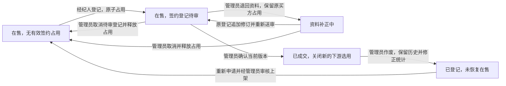

## Context

本文件是已确认业务的设计草案，尚未形成最终 Schema 和可执行实施任务。现状、字段及证据见[源码调查](investigation.md)，业务动机见[提案](proposal.md)。

现有客户跟进支持 `SHOWING`，且可通过咨询间接关联单套房源，但没有独立行程及逐套带看结构。房源可以标记 `SOLD`，但没有完整成交登记。经营统计表和复盘计划已有基础；真实复盘来源目前是房源摘要及已发布知识，未覆盖实际带看、成交和直接访谈。

## Goals / Non-Goals

**Goals**

- 让每轮带看、每套反馈及管理员确认的成交具有可回溯身份和版本。
- 让经营明细、同店排行、访谈诊断及改进计划使用一致的可信范围和来源。
- 使用原有领域能力和共同 A2A 契约衔接，不把会话或统计汇总当业务登记真源。

**设计边界**

带看、成交作为需要领域能力承载的新业务，最终服务归属仍待设计，不恢复已退役的交易、合同、结算服务。登记已签署的正式买卖合同事实，不意味着本期新增签署合同、资金监管或佣金结算执行能力。

## Decisions

### 1. 一次行程与逐套带看分别建模

正式带看先选择获准的已建档买方；临时推荐或对比结果继续保留，补齐买方引用后进入带看。一次行程可看多套房源，每套保留自己的实际情况和反馈。同一买方可再次创建行程，前轮记录继续保存。

拟议对象为 `showing_trip`、`showing_visit` 和反馈修订，名称及物理表尚未定稿。把所有情况塞进通用跟进 `content` 会使轮次、房源和统计单位无法稳定区分，因此通用跟进保留原用途，并引用新的结构化业务记录。

| 拟议对象 | 主要字段草案 | 依据及待定项 |
| --- | --- | --- |
| 带看行程 | `trip_id, buyer_profile_id, broker_id, owner_user_id, store_id, status, scheduled_at, completed_at, version` | 绑定买方角色，平台用户与经纪人身份分别验证；完成/取消规则仍需明确 |
| 逐套带看 | `visit_id, trip_id, listing_ref, listing_revision, occurred_at, status, current_feedback_revision` | 一行程多套，同一套可在另一行程复看；预约来源与实际带看事实分开保存 |
| 反馈修订 | `visit_id, revision, feedback, result, occurred_at, recorded_at, actor_user_id` | 逐套定位，校正留历史；最终结构化反馈字段继续问答确定 |

行程次数和房源被看次数是两种统计单位。建议分别统计已完成行程及已完成逐套记录；不能把一次三套行程不加说明地混为三次客户带看。预约、取消、补录和更正如何参与指标，需在发布计数契约前确定。

### 2. 正式签约事实经管理员确认后生效

双方签署正式买卖合同是成交业务发生节点。经纪人登记后先保存待审成交，管理员确认实际版本后成交才生效，再衔接房源 `SOLD` 和成交统计。签约发生时间、登记时间、确认时间分别记录。

拟议成交记录包含 `deal_id, buyer_profile_id, seller_profile_id, listing_ref, listing_revision, broker_id, owner_user_id, store_id, contract_signed_at, deal_amount_yuan, status, version`，审核记录保存 `deal_id, reviewed_version, decision_id, reviewer_user_id, decision, confirmed_at`。房源业主引用取人员档案，不能使用经纪人登录标识。

签约登记同时原子取得该房源的唯一有效占用。拟议占用记录保存 `source_system, source_id, deal_id, buyer_profile_id, reservation_version, acquired_at`，唯一范围是稳定房源身份，覆盖不同买方、经纪人及门店。不能把互斥粒度缩成某个经纪人或某个会话。持久业务占用不同于请求期间的数据库锁：记录落库后跨审批等待及进程重启保持有效，不靠 JVM 锁、临时 Redis 锁或默认超时自动释放。

同一登记操作重试返回原登记和占用引用；另一个操作不能为同一房源创建第二份有效签约登记。并发竞争失败返回“已有签约登记待处理”的业务结果，不能伪装成房源失去在售资格，也不向无权用户泄露原买方资料。登记与占用须在同一权威事务内提交，或在明确的可恢复状态中完成后才返回登记成功，不能先查询再无条件插入。

管理员因资料问题退回时，原 `deal_id`、买方引用和房源占用继续保留。补正记录明确保存 `correction_reason, requested_by_user_id, requested_at, previous_revision, corrected_revision` 等依据，并在原登记追加修订后重新送审；原审核决定不能用于修订后的版本。资料退回不记为买方放弃，不以退回这一事实推断买方责任，也不自动将责任转给其他人。补正等待仍是签约办理的一部分。

待审登记取消及占用释放仅由有权管理员处理。经纪人需要取消时经 Supervisor 交给管理员人工节点，不能通过撤回按钮、咨询关闭、结束会话或修改资料自行释放。管理员取消保存 `cancellation_decision_id, cancelled_by_user_id, cancelled_at, reason` 及当前登记/占用版本，保留原记录；释放必须精确匹配当前占用，旧取消消息不能释放后来取得的新占用。补正和取消使用不同业务动作及回执。

| 房源当前业务情况 | 推荐、安排新带看、生成营销草稿 | 新的签约登记 | 成交统计 |
| --- | --- | --- | --- |
| 在售且无有效签约占用 | 按原资格及权限允许 | 可竞争取得唯一占用 | 尚无生效成交 |
| 已登记签约，待管理员确认 | 按原在售资格及权限继续允许 | 其他买方被现有占用阻止；原操作重试返回原结果 | 尚未计为生效成交 |
| 资料退回补正，原买方占用保留 | 按原在售资格及权限继续允许 | 其他买方仍被阻止；原登记更正后重送审 | 不计生效成交，也不记为买方放弃 |
| 管理员确认成交生效 | 不再允许新的推荐、带看安排及营销草稿 | 不允许 | 计入一次有来源的生效成交 |
| 管理员作废成交，回到已登记 | 未重新上架前不允许 | 不允许直接从已登记办理新的在售签约 | 保存原成交并按作废结果修正统计 |

已确认营销草稿的发布继续使用冻结版本，本次规则不在发布阶段新增房源状态检查。尚未确认的草稿仍遵守既有确认时在售复核。历史报告、已完成带看及原成交事实按各自历史权限保留。

目标状态关系如下，不代表已实现接口；管理员取消待审登记只释放占用，在售资格继续按房源本身的当前状态判断：

目标是让生效成交及房源状态有稳定来源关联。现有直接 `SOLD` 动作需要纳入同一规则，不能绕过管理员确认。新登记、审核、更正和事件消费均需稳定幂等键与版本验证。跨域状态及统计更新采用可恢复交接及去重回执，不依赖一次前端请求同时写完所有服务。

审核确认绑定当前登记版本和占用版本，不能确认另一买方或被替换的旧登记。对外报告成交已生效之前，权威选用资格必须已经关闭；不能仅依赖稍后刷新的检索索引或缓存。若跨域交接尚未关闭资格，应返回待完成状态。统计允许按可重放事件更新，但同一生效事实只计一次。

成交生效后，由耐久业务事件触发自动取消该房源尚未进行的逐套带看，通知对应负责经纪人。一次行程包含其他房源时，只处理已成交这一套，保留其他行程项；全部未进行项均被取消时再按行程聚合规则收束。已完成的带看及反馈不被重写，进行中的处理边界继续明确。

拟议取消记录保留 `visit_id, expected_visit_version, cancellation_cause=LISTING_DEAL_CONFIRMED, deal_id, confirmation_id, cancelled_at`。按当前执行状态及版本竞争更新，不能将同时已完成的带看改为取消。重复或迟到的成交事件只处理一次，不撤销已完成的事实。即使自动处理尚在排队，旧预约也不能绕过房源当前资格重新启动。成交作废不会自动复活先前已取消的预约，房源重新上架后可重新安排。

通知目标从每条带看保存的负责经纪人及其可信用户映射取得，不能用成交登记经纪人替代所有受影响经纪人，也不能把 `broker_id` 直接当平台 `user_id`。通知仅包含该收件人有权查看的预约及取消原因，不泄露成交买方资料。通知去重绑定生效成交/取消事件和实际收件人，消费重试不重复取消或重复发消息。

成交确认、自动取消和通知分别保留回执与处理状态。取消和通知通过可恢复交接重试，通知暂时失败不回滚已经生效的成交或恢复带看。界面如实表示取消处理中、通知待送达等状态，不把入队或受理当成已送达，也不再要求经纪人人工批准系统自动取消。

管理员作废已确认成交时，保留原登记、审核及作废记录，追加 `void_decision_id, voided_by_user_id, voided_at, reason` 等审计事实，产生可去重的统计修正。原房源沿用编号、业主关联和基础资料回到“已登记”，不得直接恢复在售；再次出售仍需提交新的上架申请并由管理员审核。历史迟到的确认或索引事件必须按业务版本、作废决定和上架周期判断，不能把已作废成交重新生效或把已登记房源恢复在售。

成交发生期间以签约事实表达，确认时间保留为独立审核事实；确认后回补历史期间的具体统计处理需与指标口径一起发布。房屋成交总价与经纪人业绩/佣金不是同一字段，后者的业务定义和来源仍待确认。

### 3. 经营明细和同店排行使用不同投影

明细按经纪人本人、门店负责人本店、管理员获授权范围验证。可信经纪人和门店来自 Auth 现有身份映射，`employeeName/storeName`、客户端传入的人员或门店号均不能建立权限。

同店排行是独立的有限读取能力。返回稳定员工引用、展示名、名次及已公布的排行指标，不返回底层客户、带看、成交或访谈记录；任何下钻重新检查明细权限。具体指标、排名分数及并列规则仍需确定。

数据库查询与缓存均绑定可信门店/授权范围、统计期间、指标及规则版本。先计算全范围统计再截取榜单展示，兼容同名、人员改名、门店调整及权限变化。缺失来源用明确状态表达，不能默认为零或参与无依据的排行。

### 4. 访谈用于问题诊断及经验总结

访谈用途已明确为识别经纪人处理、门店管理、房源与客户需求匹配方面的问题，并提炼良好方法。分析输入至少区分业务登记事实、访谈陈述和已发布可复用知识；输出保留有依据结论、可能原因、待核实事项及建议，不能用一段陈述直接增加成交或带看计数。

发起业主访谈时，经纪人选择原人员档案的业主角色，由业主本人作为受访者用户参与。业主具有被访谈能力，不能因此执行房源、客户、经营或访谈治理操作。人员身份与系统操作能力分别建模，不要求为了参加访谈而另建一份业主档案。

发起经纪人、受访主体和相关业务对象分别保存。拟使用带类型的 `respondent_subject_ref`，将 `CUSTOMER_PROFILE` 人员档案引用与 `PLATFORM_USER` 内部用户引用区分，并保留 `session_id, participant_id, relation, state, revision` 及实际认证绑定。业主受访主体指向原人员档案，不能把相同数值的档案 ID 填入当前 `respondentUserId/user_id` 并认为已经认证，也不能借用经纪人的受访票据代替业主。

现有 LR-1 的登录/认证来源及场次用途票据边界继续适用：先有可信受访主体，再确认精确场次关系和 `RESPOND` 用途，票据本身不证明身份。受访者专用认证及签名主体适配仍需设计，不能通过放宽普通用户入口绕过。联系人手机可重复，不能仅以手机号相同认定是同一业主。相关 `store_ref, listing_refs, buyer_demand_refs, showing_refs` 按场景绑定，不能从名称或发起人所属门店推断全部关联。

房客匹配诊断需要使用当时的需求版本、所推荐或带看的房源版本及反馈，避免用今天的需求或房价判断过去的行为。关联范围不足、不同访谈说法不一时保留证据缺口，不自动认定某个人应承担责任。

既有 Interview 源资格、脱敏、发布、版本及撤回控制继续生效；经营分析权限不自动变成原始逐字稿读取权。具体直接访谈分析来源契约仍需设计。现有“已发布访谈 → 知识派生 → 发布知识 → 复盘引用”用于方法复用，但不能代替本门店访谈证据及业务事实。

### 5. 门店负责人确认改进计划，行动分别负责

复用 `store_review_matter / evidence / diagnosis_revision / plan_revision / action / action_receipt`。计划绑定诊断及证据版本，门店负责人经 Supervisor 人工节点确认实际版本后形成行动。

每项行动新增或明确独立的 `assignee_user_id, due_at`；已有 `actorId` 表示操作者，不得直接改作执行负责人。计划编制人、确认人、执行人和反馈操作者分别记录。原有计划级 `owner_actor_id, due_at` 保留兼容语义，不因新增逐项责任而删除。

来源变化时沿用现有复核要求，修改过的计划重新绑定版本和确认。人工执行反馈继续标记 `USER_REPORTED`；行动标记完成不等同成交、房源维护或经营效果已被来源证明。

总结出的好方法可以形成知识候选，后续沿既有知识审核、发布及来源依赖流程复用，不能由一次复盘自动发布为全员可读知识。

### 6. 统一业务交接和输入输出边界

所有受监督交互继续由 Supervisor 承担，领域间请求沿用[共同 A2A 信封](../align-listing-marketing-workflows/contracts/a2a-workflow.schema.json)。新动作使用同一动作登记机制，不能为带看、成交、访谈诊断分别发明信封。

| 边界 | 拟使用的输入 | 必须返回或区分的结果 |
| --- | --- | --- |
| 带看登记 | 获准买方、逐套稳定来源引用、时间、请求去重键 | 行程与逐套记录引用；缺少建档、来源变化、权限拒绝及依赖失败分别表达 |
| 带看反馈 | 精确逐套记录、预期版本、实际情况 | 反馈修订及当前版本，重试不重复新增 |
| 成交登记 | 获准买方、卖方/业主、房源、签约事实及发生时间、操作去重键 | 唯一签约占用及待审登记；竞争失败、重试和已生效房源分别表达 |
| 成交确认 | 登记及占用标识、审过的版本、决策标识 | 管理员确认回执、业务生效结果及已关闭选用资格的交接引用 |
| 退回补正 | 当前登记版本、补正理由、管理员决定 | 原登记及原买方占用保留、补正修订及重新送审引用；不记买方放弃 |
| 取消待审登记 | 当前登记/占用版本、管理员取消决定及原因 | 原记录保留、精确占用释放回执；经纪人不能直接取消 |
| 自动取消带看 | 生效成交及当前未进行的逐套带看引用 | 逐项取消/已完成等当前处理结果、通知回执及待重试状态 |
| 成交作废 | 生效成交、预期版本、作废决定及原因 | 管理员作废回执、原房源已登记状态、统计修正引用；不自动重新上架 |
| 经营读取 | 当前获准范围、统计期间、指标版本 | 有来源的数值或缺失状态；排行只返回其投影 |
| 访谈诊断 | 获准访谈来源及相关业务事实版本 | 有来源结论、假设/缺口、好方法候选及具体计划 |
| 计划确认 | 精确计划版本、逐项负责人和期限 | 负责人确认回执及行动引用，生成与执行状态分开 |

最终 JSON Schema 在状态、权限和边界确认后发布，必须同时覆盖输入、成功结果、等待人工、版本冲突和来源失败。金额使用带币种/单位的精确表示，时间说明业务发生与记录时间，引用包含来源系统、标识和版本。前端和模型消费同一已解析契约，语义授权由服务端校验。

## Risks / Trade-offs

- 多轮过程直接覆盖通用跟进 → 新结构保留轮次及逐套反馈，兼容原记录引用。
- 成交已确认但下游状态或统计暂未更新 → 保存确认事实和耐久交接状态，重试去重并明确数据更新时间。
- 签约占用与房源在售状态混用 → 待审仅阻止重复签约，生效后才关闭新的下游选用；两个维度分别校验。
- 作废后的旧消息再次推进成交或上架 → 用来源版本、决定及周期拒绝过期更新，保留可重放历史。
- 资料补正被计为买方失败 → 补正原因和取消原因独立表达，保留原买方占用，复盘不由退回状态推定责任。
- 取消通知失败或跨用户错投 → 独立耐久回执、准确收件人映射及受权投影，重试不恢复预约或重复通知。
- 员工同名、门店调整或权限撤销 → 稳定身份和可信范围进入查询及缓存，不能仅按显示名归并。
- 访谈陈述被当成事实或用于无依据归责 → 标明来源性质，结合当时业务版本，保留矛盾和待核实项。
- 为接入分析扩大访谈原文读取面 → 保持既有来源边界，单独设计受权分析契约。

## 实施前待确认边界

以下内容会影响状态机及输入输出，目前没有完整实施任务，不能将本草案视为可直接实施的最终契约：

1. 带看实际开始、完成和进行中的边界；成交生效时进行中的带看如何处理，以及行程聚合的具体规则。
2. 业主档案受访主体与场次邀请、认证、票据的具体接线及接口兼容；被访谈身份不会取得系统业务操作能力。
3. 带看完成/取消、反馈内容、更正历史、指标计数及业绩来源的具体口径。
4. 带看和成交领域的承载服务，新增领域动作与当前 REST/Agent 边界及历史数据迁移。
