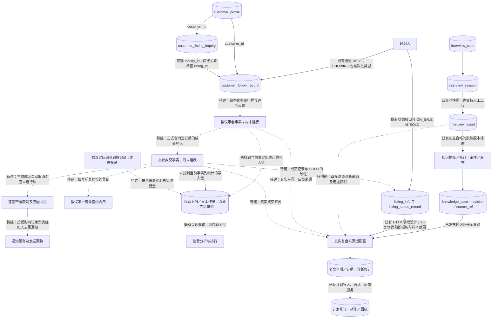

# 带看、成交、访谈与经营复盘现状调查

调查日期：2026-11-27。依据为当前活动模块源码和受管迁移；未查询业务库、执行迁移或证明联机业务已跑通。历史合同、结算和 trade 服务已退役，不计作当前能力。

## 已确认的目标与当前边界

正式带看须绑定已建档买方；一次行程可看多套房源，逐套登记反馈，并允许持续多轮。经纪人在双方签订正式合同后登记成交，管理员确认后成交才生效、房源变为 SOLD 并计入成交统计。业主本人直接参与访谈，由经纪人发起并关联已有业主档案；访谈用于诊断经纪人、门店及房客不匹配的问题，也用于总结好方法复用。经营明细按本人、本门店及管理员获授权范围查看；同门店经纪人可看排行，不能看他人明细。复盘须形成具体改进计划，由门店负责人确认，每项行动有独立负责人及期限。

补充确认：待审核签约登记仅互斥其他买方的签约登记，不阻止原在售条件下的推荐、新带看和营销草稿。成交确认生效后才关闭这些新的选用。管理员作废成交后保留历史、修正统计，房源回已登记并重新送审上架。业主档案对应受访者用户身份，仅具有获准被访谈能力，不取得系统业务操作能力。

补充确认：资料退回保留原买方及签约占用，原登记补正后重新送审，不将资料问题归责买方。待审签约取消和占用释放仅由管理员处理。成交生效后自动取消该房源尚未进行的逐套带看，并通知对应负责经纪人；已完成记录保留，其他房源安排不随之取消。

补充确认：逐套反馈由经纪人确认保存，不经管理员审批，字段为实际带看时间、客户意向、满意点、顾虑和下一步，未提供项保留未知。经营分析同时需要房屋成交总价及实际收到的佣金，分别记录来源和发生时间。

以下实线表示源码中已有调用或读写实现，**不代表运行验收通过**；虚线表示本次需补建或明确的业务对接。表间 ID 与跨库来源引用是业务关联，不据此推断数据库外键。

## 现状数据流与待补接口

图中 Interview→Knowledge 是现有版本化来源路径；Review 当前 HTTP 模式仅取房源与已发布知识。不能把已有 SHOWING 枚举或 Fixture 带看样例视为真实带看来源接通。

## 主要现有表与字段

| 业务对象／现有表 | 主要真实字段 | 现状含义与证据 |
| --- | --- | --- |
| 人员档案 `customer_profile` | `id, profile_type, name, mobile, broker_id, owner_user_id, intention, preferred_area, preferred_layout, budget_min, budget_max` | 当前单值类型及当前需求；双角色、身份去重、需求时间链已有独立待实施方案。[实体](../../../customer-service/src/main/java/com/bkanent/customer/entity/CustomerEntity.java#L12) |
| 房源咨询 `customer_listing_inquiry` | `id, customer_id, listing_id, broker_id, owner_user_id, status, validation_state, checked_listing_version, checked_at` | 单条咨询关联一套内部房源；业务状态仅 OPEN/FOLLOWING/CLOSED，不等于带看或成交。[实体](../../../customer-service/src/main/java/com/bkanent/customer/entity/CustomerListingInquiryEntity.java#L12) |
| 跟进 `customer_follow_record` | `id, customer_id, broker_id, owner_user_id, follow_type, content, result_tag, next_follow_time, inquiry_id, created_at` | SHOWING/VISIT 可写自由文本，允许多条；无独立实际带看时间、逐套反馈及行程状态。[实体](../../../customer-service/src/main/java/com/bkanent/customer/entity/CustomerFollowRecordEntity.java#L11)、[写入](../../../customer-service/src/main/java/com/bkanent/customer/service/impl/CustomerManagementServiceImpl.java#L133) |
| 房源 `listing_info` | `id, broker_id, owner_user_id, owner_customer_id, status, asking_price_yuan, version` | 业主档案、负责经纪人与房源状态不同；SOLD 仍只是现有状态动作。[实体](../../../listing-master-service/src/main/java/com/bkanent/listing/entity/ListingEntity.java#L11) |
| 状态历史 `listing_status_record` | `id, listing_id, from_status, to_status, action, reason, operator_user_id, request_id, created_at` | 状态转换同事务追加历史和 RAG outbox；当前请求只有 status，未写成交方、金额、实际签约时间，reason 也未写入。[实现](../../../listing-master-service/src/main/java/com/bkanent/listing/service/impl/ListingManagementServiceImpl.java#L425) |
| 员工经营 `employee_kpi_stat` | `employee_id, employee_name, store_name, region_name, stat_month, sale_deals, rental_deals, closed_deals, viewing_count, performance_amount` | 现有汇总行，非成交与带看原始事实；门店按名称表示。[DDL](../../../sql/migrations/20261029_platform_operations_schema.sql#L4) |
| 工作量 `employee_daily_workload` | `employee_id, employee_name, store_name, region_name, stat_date, viewing_count, new_listings, new_customers, follow_up_count` | 日汇总；未检出从已完成带看产生统计的生产写入链。[DDL](../../../sql/migrations/20261029_platform_operations_schema.sql#L32) |
| 流转／门店快照 | `listing_turnover_stat.listing_id, stat_month, listing_to_viewing_days, viewing_to_deal_days, total_turnover_days`；`store_dashboard_snapshot.store_name, stat_date, active_listing_count, today_viewing_count, today_deal_count, today_performance_amount` | 既有只读分析源；成交总价、佣金和经营业绩不能混为一个金额。[DDL](../../../sql/migrations/20261029_platform_operations_schema.sql#L53) |
| 访谈案例／会话 | `interview_case.id, scene, case_status, respondent_role, store_name, listing_name, respondent_name, created_by_user_id`；`interview_session.id, case_id, mode, status, version, started_at, closed_at` | 提纲已覆盖业主、经纪人、店长；案例缺少可核验的门店、人员档案及房源 ID 关联，姓名不能用于自动归并。[案例](../../../interview-service/src/main/java/com/bkanent/interview/entity/InterviewCaseEntity.java#L10)、[提纲路由](../../../interview-service/src/main/java/com/bkanent/interview/engine/OutlineRouter.java#L33) |
| 访谈参与者／用途票据 | `interview_participant.session_id, user_id, relation, state, invited_by_user_id, confirmed_at, revision`；`interview_participant_ticket.session_id, user_id, purpose, ticket_hash, expires_at, revoked_at, revision` | 当前参与者和票据按已认证平台 user_id 匹配。业主档案受访主体需明确类型及认证绑定，不能将档案编号直接当平台用户编号。[参与关系](../../../interview-service/src/main/java/com/bkanent/interview/service/InterviewParticipantService.java#L26)、[票据](../../../interview-service/src/main/java/com/bkanent/interview/service/InterviewParticipantTicketService.java#L43) |
| 逐字稿 `interview_asset` | `id, session_id, case_id, source, content, raw_content, snapshot_hash, archive_grade, metadata_json, content_hash, content_revision, sanitization_revision, visibility, publication_revision, approved_by_user_id, published_at` | 脱敏正文与原文分开；公开来源需显式发布、合格等级和版本校验，AUTO/UPLOAD 不证明真实业务效果。[实体](../../../interview-service/src/main/java/com/bkanent/interview/entity/InterviewAssetEntity.java#L12)、[来源读取](../../../platform-operations-service/src/main/java/com/bkanent/knowledge/source/InterviewTranscriptSource.java#L13) |
| 知识及来源 | `knowledge_case.knowledge_id, scope_type, owner_actor_id, store_id, lifecycle_state, current_revision, published_revision`；`knowledge_revision.revision_no, content_hash, body_json, evidence_level, data_mode`；`knowledge_source_ref.asset_id, snapshot_hash, content_hash, content_revision, sanitization_revision, publication_revision` | 知识修订保存访谈证据绑定；已发布知识可供获准复盘复用，不等于复盘已直接读取访谈。[DDL](../../../sql/migrations/20261029_platform_operations_schema.sql#L213)、[生成](../../../platform-operations-service/src/main/java/com/bkanent/knowledge/service/KnowledgeGenerationService.java#L122) |
| 复盘事项／证据 | `store_review_matter.review_id, store_id, actor_id, dataset_id, data_mode, status, version, matter_json`；`store_review_evidence.source_system, source_id, revision, observed_at, event_time, source_status, evidence_json` | 有来源版本和观察时间结构；当前 HTTP 来源是房源＋已发布知识，需补带看、成交及访谈用途。[DDL](../../../sql/migrations/20261029_platform_operations_schema.sql#L96)、[实际取数](../../../platform-operations-service/src/main/java/com/bkanent/businessreview/domain/DomainParallelHttpReadAdapter.java#L82) |
| 计划／动作／回执 | `store_review_plan_revision.review_id, plan_version, diagnosis_revision, owner_actor_id, due_at, parameter_hash, plan_status, plan_json`；`store_review_action.action_id, plan_version, action_version, action_status, evidence_level, feedback_note, action_json`；`store_review_action_receipt.request_id, receipt_type, receipt_json` | 已有版本化计划、确认及人工反馈。`ReviewAction.actorId` 位于 action_json，确认时写确认操作者、反馈时写反馈操作者，并非独立受派执行人。[DDL](../../../sql/migrations/20261029_platform_operations_schema.sql#L142)、[动作写入](../../../platform-operations-service/src/main/java/com/bkanent/businessreview/persistence/JdbcReviewRepository.java#L179) |

## 对实际使用的主要缺口

1. **带看事实不完整**：自由文本跟进不足以表达行程、逐套房源、实际发生时间、多轮复看和反馈。跟进新增直接 save，缺请求去重，不能直接作为带看次数的可靠计数源。
2. **成交事实不完整**：`ON_SALE→SOLD` 没有正式合同签订事件、买方、签约时间及金额的稳定关联，没有唯一签约占用及作废回已登记路径。咨询 CLOSED、人工动作 DONE 和房源 SOLD 不能相互替代，更不能直接推定业绩收入。
3. **汇总没有来源闭环**：四类经营统计表已有读接口，当前活动生产源码未检出从带看／成交事实生成或重建统计的链路。迁移对应用只授予这四表 SELECT。无来源与真实零发生需分别表达。
4. **范围与投影未分层**：经营入口使用 `business.*.all`；尚无满足“本人明细／本门店明细／授权范围／同店排行摘要”的统一契约。KI-281、KI-282 已登记总量依赖 topN、按显示名称归并的问题。
5. **访谈关联与诊断用途待接通**：现有角色提纲可复用，但文本门店名、房源名、姓名不能证明业务关联。需区分受访者陈述、可核实事实及分析假设；遵守既有脱敏、来源撤回与 LR-116/117/167 边界。
6. **计划已有骨架但责任不齐**：计划修订和确认可复用，动作没有独立受派执行人。现有反馈仅允许 USER_REPORTED，不可将人工“完成”解释为带看、成交或改进有效的客观证明。[服务](../../../platform-operations-service/src/main/java/com/bkanent/businessreview/service/ReviewApplicationService.java#L118)
7. **真实来源仍有阻断**：KI-273 已记录复盘房源 HTTP 授权不匹配，取样未绑定 storeId 与事件窗口；新增事实接入必须同时修正，不能在跨门店混样上继续生成诊断。
8. **金额来源尚未区分**：现有 `performance_amount / today_performance_amount` 是通用汇总值，MySQL 和 Redis 排行都消费它；活动模块未检出实际到账事实模型及写入链。旧 bootstrap 的佣金、结算记录属于退役路径，不能作为当前实收来源。[排行实现](../../../platform-operations-service/src/main/java/com/bkanent/business/service/impl/BusinessAnalyticsServiceImpl.java#L242)

## 拟议对象，不是现有表

- 带看行程、行程内房源及其反馈、正式合同签订后的成交登记、唯一签约占用、资料补正、管理员取消/确认/作废记录、事实修订及操作去重回执。占用绑定稳定房源和登记，补正保留原买方占用，仅管理员可取消释放；成交生效关联逐套带看自动取消、准确负责人通知、SOLD 及成交统计。具体表名、领域承载和最终字段由设计阶段确定。
- 经纪人发起的业主本人访谈及其已有业主档案受访主体、可信门店／相关房客源的明确引用及受权诊断投影；由门店负责人确认的改进计划、逐项独立负责人及期限、验收依据及后续观察。它们尚未落库或接通，不能从同名字段、任意摘要或 Memory 自动推断。
- 经纪人确认的逐套反馈修订，保留五项业务字段、未知状态及实际确认人；成交登记中的实际成交总价，和另行关联成交的实际佣金到账事实。实收登记及生效、分次到账、退款和多人归属尚在澄清，不能用挂牌价或历史通用业绩值填充。
